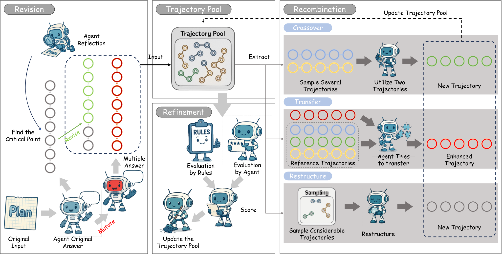

# SE-Agent: Self-Evolution Trajectory Optimization in Multi-Step Reasoning with LLM-Based Agents

> StepFun / Tsinghua University / Huazhong Agricultural University · 2025-08-04 · paper · **闭环** · [论文](https://arxiv.org/abs/2508.02085) · [仓库](https://github.com/JARVIS-Xs/SE-Agent)
> 机制族：经验积累与回放 · 来源核验 2026-09-17 · 复现状态 not-run

## Pipeline

轨迹级自进化：智能体经三种操作迭代重访早前解轨迹——修订、重组、精炼——利用逐步搜索（MCTS 式）忽略的跨轨迹启发，把搜索空间扩到局部最优之外，并把改进策略持久化给后续问题。

*图源：Figure 1*
## 结果（作者报告，非本地复现）

SWE-bench Verified、五个 LLM：相对改进最高 55%，v6 时开源智能体中最优（摘要口径；逐基线数字不在摘要页）。

## 证据边界

本次审计中的头条数字为摘要口径（逐基线表未从 HTML 复核）；v1 首发日期早于滚动窗口，本条目作归档背景而非窗口内证据。

## 对 nanoRSI 的输入

对 nanoRSI：对已存轨迹做修订/重组/精炼是运行档案的廉价二次利用——生成新候选前，先挖掘过往尝试的跨轨迹重组。

## 来源

[arXiv abstract](https://arxiv.org/abs/2508.02085) · [Paper v6 (Figure 1, mechanism)](https://arxiv.org/html/2508.02085v6) · [Code repository](https://github.com/JARVIS-Xs/SE-Agent)
