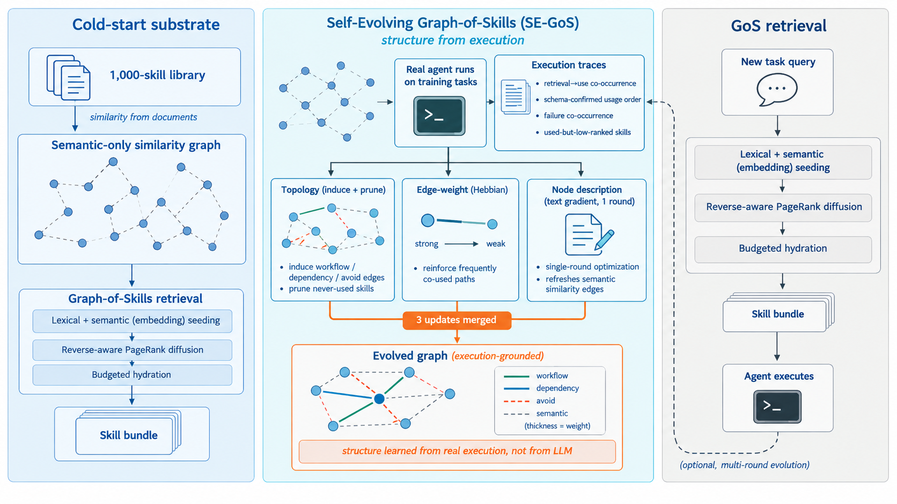

# SE-GoS: Self-Evolving Graph-of-Skills for Skill Library at Scale

> Peking University / Tencent / University of Edinburgh / Northwestern University / Tsinghua University · 2026-09-08 · paper · **闭环** · [论文](https://arxiv.org/abs/2609.08228)
> 机制族：结构化知识库与图 · 来源核验 2026-09-15 · 复现状态 not-run

## Pipeline

对既有 Graph-of-Skills 检索图做免训练进化：真实执行轨迹驱动三类更新合并为一轮离线进化——拓扑进化（按共现诱导工作流/依赖/回避边、剪除从未使用的技能）、赫布式边权进化（强化频繁共用的路径）、节点描述进化（单轮“文本梯度”刷新面向检索的描述）。检索算法、技能内容与模型权重均不动——只有检索状态随执行改变，且进化后沿用同一检索接口。

*图源：Figure 1*
## 结果（作者报告，非本地复现）

在 SkillsBench、三个 LLM 上，一轮进化把平均任务奖励从 52.4% 提到 59.4%，同时相对整库加载 1,000 技能把平均输入 token 削减约三分之一。进化图可迁移到不相交的 37 任务留出集，比静态 GoS 基线 +5.4 分。收益随模型家族波动；多轮进化（表 4，每轮 n=174 次尝试）继续有效但边际递减。

## 证据边界

进化是离线的，需要训练任务的真实运行池；指标是单一基准（SkillsBench）上计分尝试的平均；未发布代码；冷启动基座是给定的 1,000 技能库，其构建方式不在方法范围内。

## 对 nanoRSI 的输入

给 nanoRSI 加一道免训练的检索保养工序：每批评测后从运行日志挖掘共用与从未使用的原语，只调整检索图（边、权、描述）而不改技能内容，并在留出任务集上验证后再采用。

## 来源

[arXiv abstract](https://arxiv.org/abs/2609.08228) · [Paper v1 (affiliations, Figure 1, Tables 2-4)](https://arxiv.org/html/2609.08228v1)
