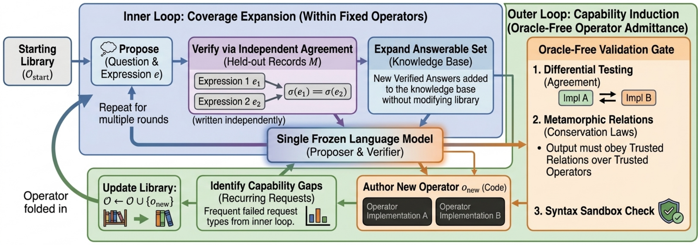

# A Self-Improving Agent that Grows its Own DSL: Oracle-Free Operator Induction for Exact Question Answering

> PayPal AI · 2026-10-14 · paper · **闭环** · [论文](https://arxiv.org/abs/2610.20809)
> 机制族：程序进化与进化搜索 · 来源核验 2026-10-18 · 复现状态 not-run

## Pipeline

单一冻结模型在小而精确的 DSL 上跑双层循环：无奖励、无裁判、无答案钥匙。内层在固定算子库内扩张可答问题集：每条候选表达式必须由第二次独立重写的表达式在全部验证记录上一致才保留。外层发现重复出现的能力缺口，把新算子写成沙箱内无方法调用的 Python，且只有通过三段无 oracle 闸门才准入：差分测试（两个独立实现全记录加模糊输入一致）、已信任算子之上的蜕变守恒律、以及内层独立一致检查的往返验证。

*图源：Figure 1 (method_overview.png), arXiv HTML 2610.20809v1*
## 结果（作者报告，非本地复现）

可答集增长：Merchant 10→336、BookSQL 15→162、EHRSQL（MIMIC-III）13→248；仅内层循环就把覆盖面约扩为三倍（13 个起始集平均 +18.3）。闸门健全性在 14 个被准入算子的全部单点突变体上测得：非相关参照下 0/138 缺陷变体被准入（两个实现带同一缺陷的相关最坏情形下 10/138），对照 admit-if-it-runs 129/138、self-consistency 129/138、压缩法 101/138；LLM 裁判还错误拒绝 2/14 个正确算子。机制不做修改即跨模型家族迁移（主模型 Qwen3.6-35B-A3B；Mistral-Small-24B、Llama-3.3-70B、Gemma-3-27B 也能自我扩展）。

## 证据边界

mode（众数）归约器永久不可达，因为不存在对应的守恒律；只测了至多 3 轮归纳；81% 的准入拒绝源于沙箱禁用的方法调用；存在一例对抗逃逸（见证关系引用裸内建函数而非受信任算子时，改变尺寸的合并缺陷被准入）；种子集中在按组聚合族；Gemma-3-27B 只在一个种子上自我扩展（DSL 编译率 13%）。

## 对 nanoRSI 的输入

精确任务上无 oracle 闸门的范本：双独立实现加守恒律替代留出标签，可直接用于 nanoRSI 有可验证不变量但无金标面板的场景。同样可移植的是审计协议——对每条被接受的编辑生成全部单点突变体并测闸门误准入率——可为反事实/挑战闸门给出论文级健全性分数。

## 来源

[arXiv abs 2610.20809](https://arxiv.org/abs/2610.20809) · [arXiv HTML v1](https://arxiv.org/html/2610.20809v1)
