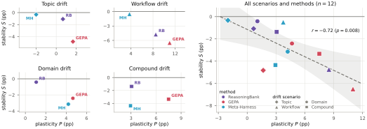

# Are Self-Evolving Agents Continual Learners?

> Mila / Université de Montréal；作者注明 student researcher at Google DeepMind · 2026-10-19 · paper · **人在环上/研究评估** · [论文](https://arxiv.org/abs/2610.25858)
> 机制族：持续任务流中的 harness / memory 演化 · 来源核验 2026-11-03 · 复现状态 not-run（未核验到官方代码、权重或数据包）

## Pipeline / 流程

论文把持续学习写成任务流：模型参数保持冻结，evolver 根据历史 episode 更新 harness。实验比较三种非参数自演化方法——ReasoningBank（相似度检索记忆）、GEPA（重写共享 strategy prompt）和 Meta-Harness（编辑 prompt、memory、skills 与 controller）——在 topic、workflow、domain、compound 四种漂移上的表现。每 50 个流位置冻结一次 harness，在所有任务组的留出集上检查；每个实例平均 8 次 rollout，分别报告总体优势、块内 plasticity、跨块 stability、pre-block interference 与 post-block forgetting。

## 结果（作者报告，非本地复现）

- 四种漂移平均的 terminal advantage：GEPA **+3.7 pp**、ReasoningBank **+2.5 pp**、Meta-Harness **+1.4 pp**；但 topic drift 的净变化分别为 **−1.7、+0.3、−1.5 pp**。
- plasticity 与 stability 在 12 个“方法×漂移”点上呈清晰负相关；GEPA 平均 plasticity **+6.2 pp**、稳定性损失 **−4.3 pp**，ReasoningBank 平均 plasticity **+3.3 pp**、稳定性损失 **−1.9 pp**。
- 相似度检索不能单独识别冲突工作流：BFCL-Miss 与 BFCL-Base 的查询相似度几乎不可分，末端分别有 **52%** 与 **46%** 的评估 episode 取到对方工作流记忆。
- 这是对当前 self-evolving agent 作为 continual learner 的限制性证据，不是 nanoRSI 的复现，也不是“通用 RSI 已解决”的证据。

## 证据边界 / Evidence limits

论文为 arXiv v1，页面标注 CC BY 4.0；本轮未核验到官方代码、权重或可下载数据/实验包。结果来自 BIRD、BFCL、ScienceWorld 构造的四种漂移流，使用作者选定的模型、harness、任务顺序和评测预算；因此不能直接推出 nanoRSI 的默认选择器应采用某一种更新策略。相似度阈值、共享 prompt 隔离和防遗忘结论仍需在本仓库的冻结评测器与多种子协议中单独验证。

## 对 nanoRSI 的输入 / Actionable input

把现有 selector study 扩展为一个只读的 continual-stream 审计：对每次接受的编辑同时保存当前任务收益、未见任务 pre-block interference、已见任务 post-block forgetting，以及 memory 命中的来源任务与工作流标签。至少比较共享全局编辑、任务条件化记忆和拒绝冲突记忆三臂；在匹配 token/episode 预算、冻结留出集和父代同场重测下报告 plasticity–stability 曲线。默认晋升逻辑不变；先记录冲突与遗忘，再决定是否需要隔离或撤回。

## 来源 / Sources

[arXiv abstract](https://arxiv.org/abs/2610.25858) · [arXiv HTML v1](https://arxiv.org/html/2610.25858) · [Figure 2 原始 SVG](https://arxiv.org/html/2610.25858v1/fig_ps_frontier.svg) · [arXiv CC BY 4.0 license](https://info.arxiv.org/help/license/index.html)
