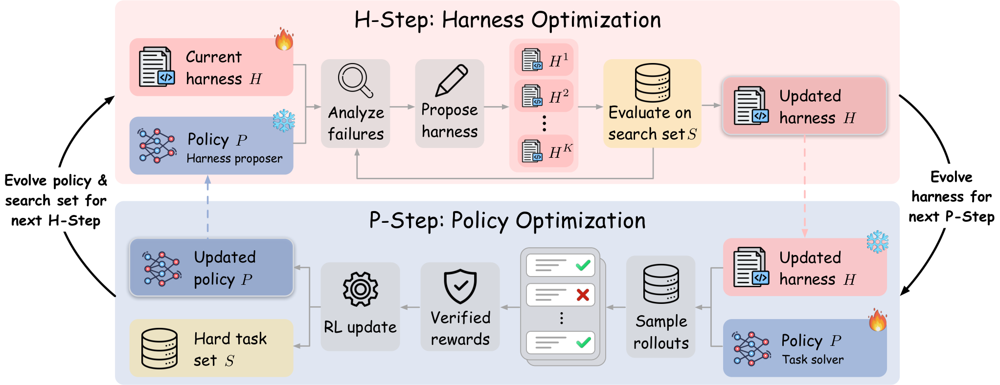

# Self-Evolving Coding Agents via Harness-Policy Optimization

> Microsoft Research / Carnegie Mellon University / University of Virginia · 2026-10-19 · paper · **闭环** · [论文](https://arxiv.org/abs/2610.22791) · [仓库](https://github.com/MSR-Orchard/Self-HPO)
> 机制族：Harness 搜索与进化 · 来源核验 2026-10-20 · 复现状态 not-run

## Pipeline

在同一个智能体上交替两步的递归自改进。H 步：冻结的策略分析自己在搜索集上的失败并提出 harness 候选——一个继承种子 mini-SWE-agent 的 Python 类，可覆写 step、提示、反馈与提交处理；候选在该搜索集上选出。P 步：策略在选定 harness 下用 RL 更新，其间从未解出的任务成为下一搜索集，使 harness 优化始终对准策略演化中的失败模式。演化中的策略自身即 harness 提案器（无需外部模型）。

*图源：Figure 2 (method_overview.png), arXiv HTML 2610.22791v1*
## 结果（作者报告，非本地复现）

Qwen3.5-35B-A3B 基座、三个编码基准（avg@3）：SWE-Bench Verified 解题率 61.0%→69.5%（自提案），外部 Opus 4.8 提案器达 71.6%；三基准平均 57.8%→64.8%，增益迁移到分布外的 SWE-Bench Multilingual（300 题）与 SWE-Bench Pro V2（642 题）；harness+策略联合增益超过各自增益之和，且两组件与对方基座版本配对时增益仍保留；消融：RL 71.6% 对 SFT 67.2%/RFT 70.5%，演化搜索集 71.6% 对固定集 70.1%。

## 证据边界

仅编码任务，各对照固定算力与 rollout 预算且限单一 harness 族（mini-SWE-agent 子类化）；最强的 71.6% 依赖外部前沿提案器而非纯自提案；协同效应依赖此交替调度。

## 对 nanoRSI 的输入

在最小任务上移植交替调度：每个接受的 nanoRSI 代后，用当前候选恰好失败的 episodes 重建提案搜索集，并让技能文件编辑与策略侧代理量（如提示/选择参数）交替，检验同预算下交替是否优于单改变面。

## 来源

[arXiv abs 2610.22791](https://arxiv.org/abs/2610.22791) · [arXiv HTML v1](https://arxiv.org/html/2610.22791v1) · [MSR-Orchard/Self-HPO (MIT)](https://github.com/MSR-Orchard/Self-HPO) · [Self-HPO LICENSE (MIT)](https://raw.githubusercontent.com/MSR-Orchard/Self-HPO/main/LICENSE) · [Hugging Face checkpoints](https://huggingface.co/self-hpo)
