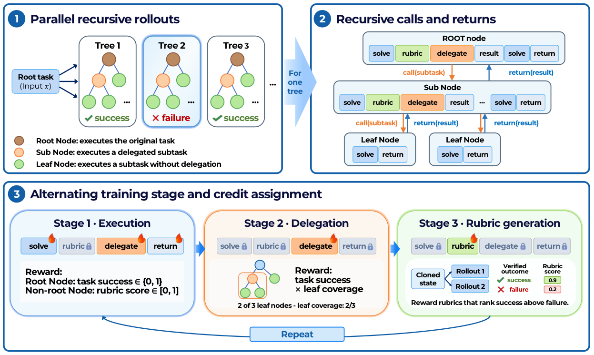

# Self-Evaluating Recursive Agents

> Tongji University / Independent / Shanghai Artificial Intelligence Laboratory / Shanghai Jiao Tong University / Peking University 等 · 2026-10-04 · paper · **闭环** · [论文](https://arxiv.org/abs/2610.04902) · [仓库](https://github.com/OliverLeeXZ/SERA)
> 机制族：Harness 搜索与进化 · 来源核验 2026-10-09 · 复现状态 not-run

## Pipeline

SERA 训练同一个递归策略同时进行任务分解、子任务执行和结果评估。委派前，父节点先写出加权 rubric；rubric 生成训练根据已验证的成功/失败延续进行排序，执行阶段使用习得 rubric 作为稠密子任务信号，并用叶节点覆盖率奖励有效分解。改变对象是策略的递归训练与评估行为，推理时还复用 rubric 做树选择；这是有界递归智能体方法，不是无限制模型自替换证据。

*图源：Figure 2 (training.png): recursive execution, leaf-coverage credit and rubric-generation credit assignment*
## 结果（作者报告，非本地复现）

论文报告公开 checkpoint 在 632 个 TextCraft-Synth 任务上的三次运行平均成功率为 74.31%，在 1,400 个 TextWorld-Sync 任务上为 65.07%；相对递归智能体基线分别提升 5.38 和 13.14 个百分点，推理时 rubric 引导树选择在 TextWorld-Sync 上再提升 2.43 个百分点。这些是论文在其模型、任务、训练和计算条件下的作者结果，不是 nanoRSI 复现。

## 证据边界

该方法依赖较重的训练基础设施（AReaL、Ray、PyTorch/vLLM 及可选外部裁判），且核验到的仓库根目录没有 LICENSE；检查到的只是第三方 Platoon MIT 声明。仓库包含基准文件并链接公开 Hugging Face checkpoint，但数据与 checkpoint 条款并非一个统一的项目级许可。报告增益只覆盖两个任务族上的递归智能体训练与选择，不能证明通用递归自改进或向 nanoRSI 迁移。

## 对 nanoRSI 的输入

只复用可移植的对照思路：未来递归智能体轨道可在相同执行器、任务面板、种子和 token 预算下比较外部裁判、固定 rubric 与习得 rubric；分别记录 rubric 生成成本、分解/叶覆盖率、执行成功、选择器决策和留出迁移。这可扩展现有验证器/控制研究，但 AReaL 训练栈和 SERA 代码不应成为 nanoRSI 依赖，本轮不改变默认行为。

## 来源

[arXiv abstract](https://arxiv.org/abs/2610.04902) · [arXiv HTML v1 and Figure 2](https://arxiv.org/html/2610.04902v1) · [Official implementation](https://github.com/OliverLeeXZ/SERA) · [Official checkpoint page](https://huggingface.co/Litux12138/SERA) · [Third-party notices in implementation](https://github.com/OliverLeeXZ/SERA/tree/main/Runtime/licenses)
