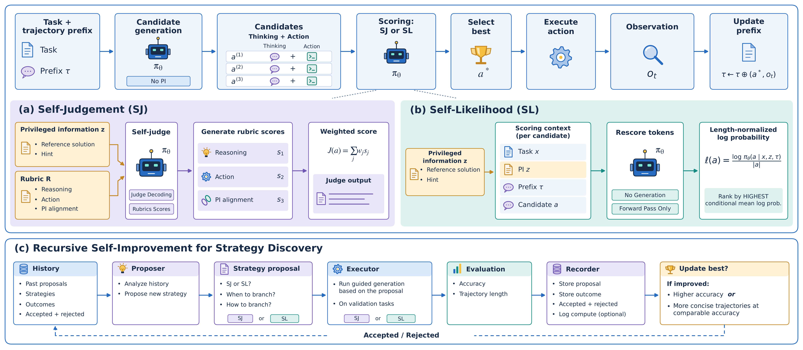

# (Self-Improving)² Coding Agents: Curating High-Quality Trajectories via Recursive Self-Improvement

> Self-Improving-Coding-Agents project · 2026-09-11 · release · **闭环** · [论文](https://github.com/Self-Improving-Coding-Agents/SI2CA) · [仓库](https://github.com/Self-Improving-Coding-Agents/SI2CA)
> 机制族：Harness 搜索与进化 · 来源核验 2026-10-07 · 复现状态 not-run

## Pipeline

在 turn 层，冻结的后端模型生成多个候选动作，并用 self-judgement（基于特权信息的评分表加权打分）或 self-likelihood（长度归一化条件似然）选择动作。独立的递归策略发现环读取历史提案、策略、结果及接受/拒绝候选，提出何时以及如何分支，在验证任务上评估策略，并且只有在准确率提高或准确率相当但轨迹更短时保留。后续 SFT 阶段使用筛选后的轨迹；这里改变的是持久轨迹/策略状态，不是自主更新模型权重的闭环。

*图源：README Figure 1; linked editable method overview PDF*
## 结果（作者报告，非本地复现）

README 报告的作者结果包括 SWE-bench Verified（500 题）：Qwen3.5-35B-A3B 的 self-judgement 为 70.0%，标准组为 65.8%（+4.2），self-likelihood 为 66.8%；Qwen3.5-122B-A10B 的 self-judgement 为 71.0%，标准组为 67.0%（+4.0），self-likelihood 为 69.8%。SWE-bench Pro（731 题）上，122B self-judgement 为 58.5%，标准组为 48.0%（+10.5）。DeepSWE（113 题）上，四次 Terra 运行报告 67.5±2.5%，标准组为 64.4±2.0%，平均 turn 数为 52.3 对 59.3。这些是项目报告结果，不是 nanoRSI 复现结果。

## 证据边界

公开来源是带方法图和 README 表格的发布仓库，而不是已单独核验的论文成品。完整基准运行需要模型端点或大型本地模型、兼容 Docker 的任务沙箱、外部基准输入和大量计算；README 中 DeepSWE 的 Terra 比较使用四次独立运行，而 Luna 只有一次。因此这些增益不能证明通用 RSI、模型权重自改进或向 nanoRSI 的迁移。

## 对 nanoRSI 的输入

只复用可检查的部分：在 nanoRSI 现有 evidence ledger 上增加有界策略发现臂，固定执行器、评估器和冻结留出任务。在匹配调用、token 和种子的条件下比较无策略搜索、固定策略及递归提出分支时机三组；记录每个策略的接受/拒绝，以及轨迹变短时留出集成功率是否保持。不引入 SI2CA 的训练栈，也不把其基准增益当作本地证据。

## 来源

[Official repository README](https://github.com/Self-Improving-Coding-Agents/SI2CA) · [Method overview PDF](https://raw.githubusercontent.com/Self-Improving-Coding-Agents/SI2CA/main/data/method_editable.pdf) · [Repository license](https://raw.githubusercontent.com/Self-Improving-Coding-Agents/SI2CA/main/LICENSE) · [Training trajectories dataset](https://huggingface.co/datasets/Self-Improving-Coding-Agents/SI2CA-Training-Trajectories) · [Dataset card](https://huggingface.co/datasets/Self-Improving-Coding-Agents/SI2CA-Training-Trajectories#dataset-card-for-si2ca-training-trajectories)
