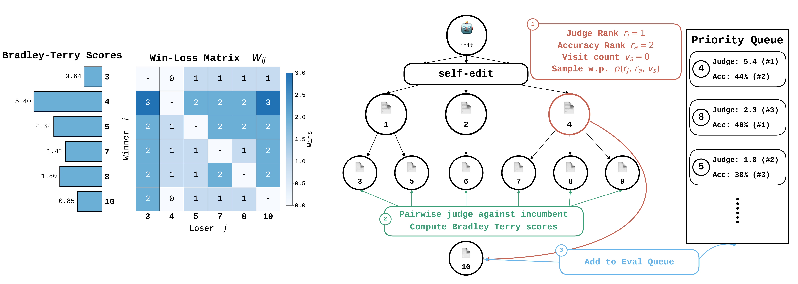

# Self Improvement via Fast Tree-search

> MIT / Sakana AI · 2026-09-17 · paper · **闭环** · [论文](https://arxiv.org/abs/2609.19526)
> 机制族：自改写元智能体与谱系 · 来源核验 2026-10-11 · 复现状态 not-run

## Pipeline

编码智能体在树搜索中递归修改自身实现。SIFT 在该循环内加入廉价监督信号：LLM 裁判对候选补丁与历史版本做两两比较，胜负记录经正则化 Bradley-Terry 模型聚合为强度分数，并按排名进行父节点采样使扩展偏向更强节点；昂贵的下游基准评测只留给最有希望的节点，另有一个解耦流水线变体允许在完整评测结束前扩展已获得强裁判信号的节点。

*图源：Figure 1 (figures/pipeline_full_bigfont.png): node expansion with judge comparison, Bradley-Terry aggregation and rank-based parent sampling*
## 结果（作者报告，非本地复现）

作者报告的完整 Polyglot 基准结果：o3-mini 智能体加 gpt-5.4 裁判的 SIFT 达 35.1%，对照 DGM（o3-mini）30.7%、基础智能体 14.2%；o3-mini 配置重复运行为 32.0-35.6%，Qwen3-Coder-30B 配置达 32.0%。o3-mini 运行在 50 CPU 小时、5 小时墙钟内完成，Qwen3 配置在 250 CPU 小时、7 小时内完成。论文还报告发现的智能体 harness 可跨编码模型迁移。以上均为作者在其基准与 API 预算下的报告，不是 nanoRSI 复现。

## 证据边界

主要增益依赖裁判模型：裁判为 None 的 SIFT 仅 29.8%（低于 DGM 的 30.7%），gpt-5-mini 裁判配置为 31.6%，裁判质量与成本是承重点。评测以 Polyglot 为主、TerminalBench 为辅，且核验的论文页面未发现代码、权重或数据发布。墙钟与 API 成本数字依赖作者 2026 年的 API 价格与基础设施。

## 对 nanoRSI 的输入

可移植部分是廉价预闸门：用两两 LLM 裁判比较加 Bradley-Terry 聚合，在任何完整面板评测前对提案做低成本排序，并与完整评测闸门显式对照，记录误准入/误拦截与裁判成本。这可以纳入已冻结的 RRSI 式选择器研究与反事实面板；属于拟议受控实验，不是 nanoRSI 默认行为。

## 来源

[arXiv abstract](https://arxiv.org/abs/2609.19526) · [arXiv HTML v1 and Figure 1](https://arxiv.org/html/2609.19526v1)
