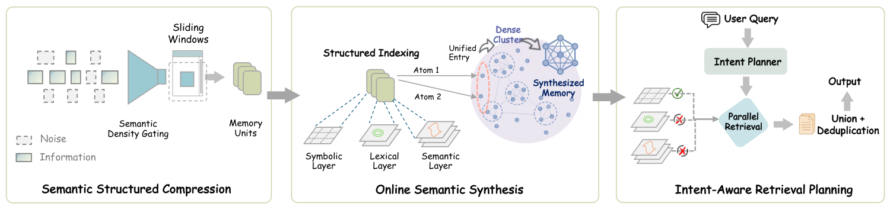

# SimpleMem: Efficient Lifelong Memory for LLM Agents

> University of North Carolina at Chapel Hill / UC Berkeley / UC Santa Cruz · 2026-01-05 · paper · **支撑·无闭环** · [论文](https://arxiv.org/abs/2601.02553) · [仓库](https://github.com/aiming-lab/SimpleMem)
> 机制族：经验积累与回放 · 来源核验 2026-09-19 · 复现状态 not-run

## Pipeline

终身记忆三段流水线：语义结构化压缩过滤低效用对话、在线语义合成做巩固、检索时按意图规划多视图查询——替代全文上下文或迭代过滤。

*图源：Figure 2 (Fig_framework_v2.png)*
## 结果（作者报告，非本地复现）

GPT-4.1-mini 在 LoCoMo：平均 F1 43.24 vs Mem0 34.20、全文上下文 18.70，每次查询仅 531 token（约为全文/MemGPT 16,910 的 1/30）；LongMemEval-S 83.97% vs Mem0 58.51%；记忆构建 92.6s/样本 vs Mem0 1350.9s。

## 证据边界

作者自报于长程对话基准；属支撑设施——记忆系统并不改进改进器本身；MIT 代码且社区采用已强（3.8k 星）。

## 对 nanoRSI 的输入

先压缩再巩固的两段式是 nanoRSI 技能记忆的 token 预算杠杆：写入时过滤低效用轨迹、周期性巩固、按意图检索。

## 来源

[arXiv abstract](https://arxiv.org/abs/2601.02553) · [Paper HTML (affiliations, Table 1, Figure 2)](https://arxiv.org/html/2601.02553v3) · [Code repository](https://github.com/aiming-lab/SimpleMem) · [ICLR virtual page](https://iclr.cc/virtual/2026/10018638)
