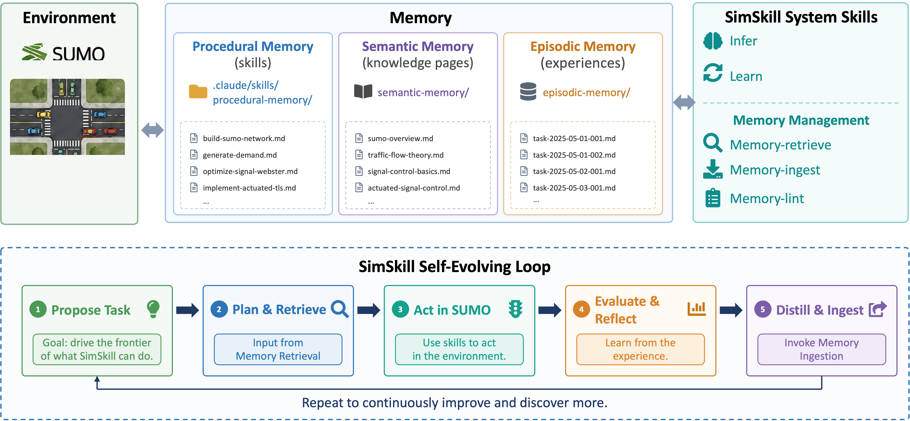

# SimSkill: A Self-Evolving LLM Agent for Skill and Knowledge Accumulation in Traffic Simulation

> Jilin University / Tongji University · 2026-09-03 · paper · **闭环** · [论文](https://arxiv.org/abs/2609.03753) · [仓库](https://github.com/qiliuchn/SimSkill-V1)
> 机制族：技能文件优化与技能库 · 来源核验 2026-09-15 · 复现状态 not-run

## Pipeline

基于 SUMO 交通仿真与 Claude 式技能运行时。学习模式下，智能体识别自身能力缺口、自生成环境锚定任务并求解，经行动-批评环验证后，把结果蒸馏进三种记忆：情景记忆（带日期的任务经验）、程序记忆（.claude/skills 风格可执行技能）、语义记忆（策展知识页）。推理模式从记忆库检索；专门的记忆管理技能负责检索、摄取与 lint。其自进化环为：提议任务、规划检索、SUMO 执行、评估反思、蒸馏入库。

*图源：Figure 1*
## 结果（作者报告，非本地复现）

在两个留出基准、三个骨干 LLM 上评测，结果经作者所述的独立验证协议核验：验证成功率相对无记忆基线最多 +25 个百分点。消融显示程序记忆与语义记忆互补贡献；收益依赖骨干与算力预算——记忆并非对每个模型都有效、也不总降低推理成本，作者将其保留为警示。

## 证据边界

限于 SUMO 交通仿真领域；“独立验证”指论文内自述的验证协议而非外部审计；v3 在八天内两次修订，若有更新版本应复读数字。

## 对 nanoRSI 的输入

缺口驱动的任务生成小型化：让 nanoRSI 提案者维护显式“能力缺口”清单，按缺口生成环境锚定的探针任务，把验证通过的解存为可复用技能——在最小任务上复刻提议、执行、评估、蒸馏回路。

## 来源

[arXiv abstract](https://arxiv.org/abs/2609.03753) · [Paper v3 (affiliations, Figure 1, memory listings)](https://arxiv.org/html/2609.03753v3) · [Author code repository (Apache-2.0)](https://github.com/qiliuchn/SimSkill-V1)
