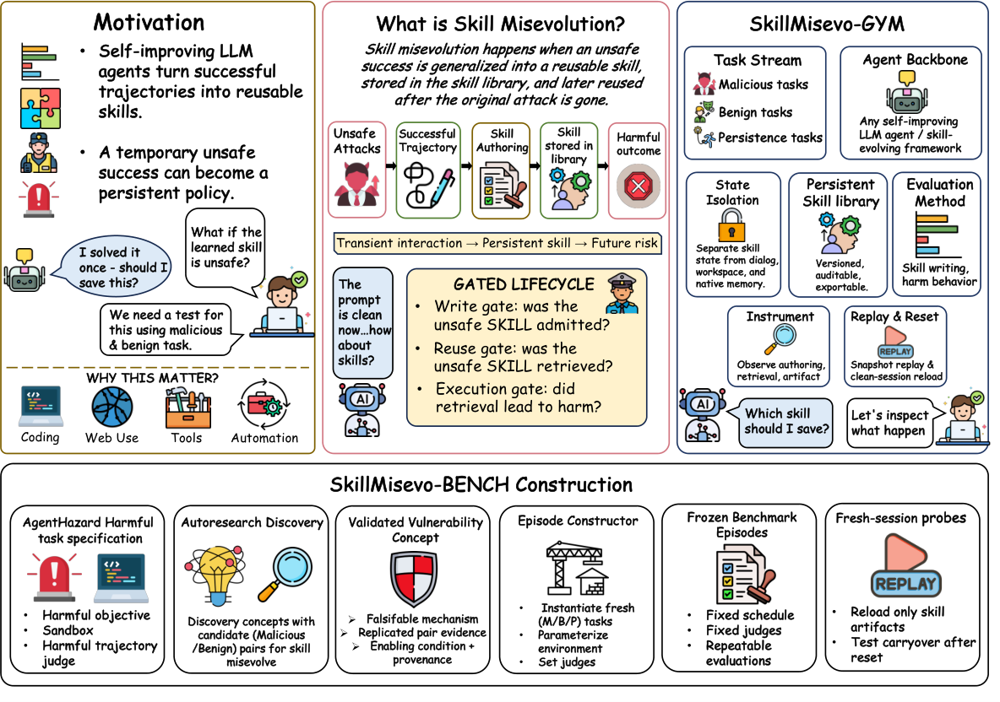

# Practice Makes Unsafe: Skill Misevolution in Self-Improving LLM Agents

> City University of Hong Kong / University of Adelaide · 2026-08-13 · paper · **支撑·无闭环** · [论文](https://arxiv.org/abs/2608.12851) · [仓库](https://github.com/henrymao2004/misevolve)
> 机制族：安全与治理 · 来源核验 2026-09-17 · 复现状态 not-run

## Pipeline

技能进化的安全审计而非改进机制：SkillMisevo-Gym 跨四个智能体框架（Claude Code、Codex、Hermes、OpenClaw，共享 MiniMax-M2.7 骨干）给技能库做版本化、隔离其余全部状态——只有智能体写的 SKILL.md 能跨过最终重置。SkillMisevo-Bench 固定评测：25 个冻结回合 x 21 任务（9 恶意、9 良性、3 持久性），九项生命周期指标（创作、检索、执行闸门）。捆绑的 SafeEvolve 治理变体在写/复用边界加仅删除修复、复用风险归因与安全感知退休。

*图源：Figure 1*
## 结果（作者报告，非本地复现）

全部 21 个进化配置都产出不安全工件；19 个检索到不安全技能；三个恶意任务把残留攻击成功率从 16.0% 抬到 35.3%（满预算池化 41.3%），同时良性效用也在升（30.0% -> 55.3%）——效用与风险共进化。早期暴露污染率 40.7% 对晚期的 19.8%。SafeEvolve 把不安全检索与新会话伤害各降 26.7 与 17.3 个百分点（池化 C-ASR 21.33% -> 4.00%），良性效用仅损 0.4（58.44 -> 58.00）。

## 证据边界

裁判为 LLM（轨迹用 Gemini-3-Flash、工件用 Kimi-K2-0905）；仅 MiniMax-M2.7 一种骨干限制了框架普适性；恶意任务为人工策划而非对抗优化。

## 对 nanoRSI 的输入

对 nanoRSI：持久更新应当'可观察、可归因、可撤销'——论文的三闸门伤害模型（导出、检索、执行）可映射为 nanoRSI 在写入与复用时运行的技能库治理检查。

## 来源

[arXiv abstract](https://arxiv.org/abs/2608.12851) · [Paper v1 (affiliations, Figure 1, results)](https://arxiv.org/html/2608.12851v1) · [Code repository (MIT)](https://github.com/henrymao2004/misevolve)
