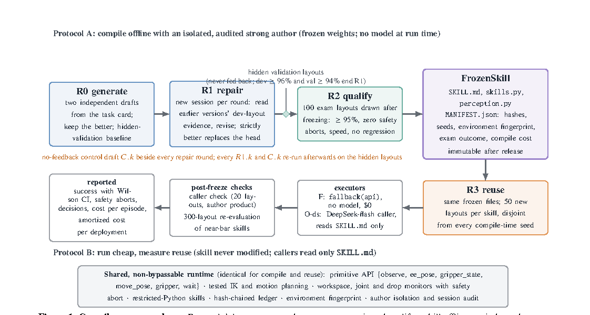

# Compile Once, Run Cheap: Frozen, Portable Skills for Embodied Agents, and What Recursive Self-Improvement Adds

> Beijing Ou Rui Ling Shi Technology (Orillusion) / ChangingTek Robotics Technology (Suzhou) / Shanghai Yunfan Intelligent Control Robot Technology · 2026-10-20 · paper · **闭环** · [论文](https://arxiv.org/abs/2610.25114) · [仓库](https://github.com/Orillusion/embodied-skill-rsi)
> 机制族：技能文件优化与技能库 · 来源核验 2026-10-21 · 复现状态 not-run

## Pipeline

带显式编译协议的技能级递归自改进。强通用模型仅作为隔离、受审计的离线作者，在仿真中编写、运行、诊断并修复一个操作技能，直到通过在冻结之后才抽取的布局考试；冻结技能（SKILL.md、skills.py、perception.py 加含哈希、种子、环境指纹、考试结果与编译成本的 MANIFEST）之后仅以代码独立运行、或由只读其描述的廉价调用者驱动。全程设对照：每轮修复旁有无反馈对照草稿、仅继承对照、永不回灌的隐藏验证布局、以及用另一模型家族执行器运行同一文件的复用协议。

*图源：Figure 1 cropped from PDF page 2 (HTML figure assets absent); gs 150dpi render, bbox (77,99,1199,700)*
## 结果（作者报告，非本地复现）

在 7 个 RoboTwin 2.0 任务上，Claude Code 把 4 个任务编译为 7 个冻结技能（5 个首稿即只需资格验证），单个作者成本 4.29-8.22 美元（计入 13 次失败战役后为每技能 55 美元）；另外 3 个任务在 18 次战役中未编译成功（含 5 次用 GPT-6 与一次预注册的 150 布局运行）——最难任务每次战役 78-95/100 但有 3-16 次安全中止，未过“95% 成功且零中止”闸门；继承早前证据的修复在隐藏布局上胜过重写；冻结技能跨执行器模型家族迁移。

## 证据边界

仿真编译技能、任务集小；作者成本如实计入失败；100 局考试对中止率的界很宽；三个未编译任务如实按失败报告、未做修饰。

## 对 nanoRSI 的输入

该编译协议正是本仓库冻结教义在具身技能上的镜像：把“每轮修复旁配无反馈对照草稿”与“仅继承”对照作为标准实验臂；被接受候选用发布 MANIFEST（哈希、种子、环境指纹、考试结果、编译成本）打包为交付标准。

## 来源

[arXiv abs 2610.25114](https://arxiv.org/abs/2610.25114) · [arXiv HTML v1](https://arxiv.org/html/2610.25114v1) · [Orillusion/embodied-skill-rsi (Apache-2.0)](https://github.com/Orillusion/embodied-skill-rsi) · [embodied-skill-rsi LICENSE (Apache-2.0)](https://raw.githubusercontent.com/Orillusion/embodied-skill-rsi/main/LICENSE)
