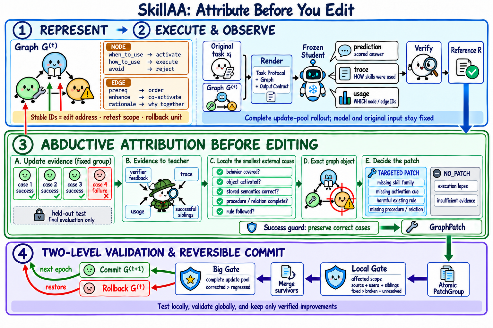

# SkillAA: Attribution-Guided Skill-Graph Updating with Targeted Validation and Rollback

> Nanjing University · 2026-09-17 · paper · **闭环** · [论文](https://arxiv.org/abs/2609.20455) · [仓库](https://github.com/Ziqiao-Shang/SkillAA)
> 机制族：技能文件优化与技能库 · 来源核验 2026-09-19 · 复现状态 not-run

## Pipeline

在冻结模型上，对比成功/失败 rollout 把每次失败归因到具体技能图对象；修复只编辑被选中的局部结构，Local 与 Big 双闸门在提交前验证候选变更并支持回滚。

*图源：Figure 2 (images/2.png)*
## 结果（作者报告，非本地复现）

gpt-5.6-sol 下 SkillAA 达 SearchQA 81.5%、LiveMath 66.7%、DocVQA 91.2%，在所有主设置中观测均值最高；消融支持结构化表示、归因条件编辑与 Local-Gate 回归控制的作用。

## 证据边界

作者自报且摘要无外部基线数字；对照在论文表格内；代码仓库无 LICENSE 文件（默认保留所有权利）。

## 对 nanoRSI 的输入

nanoRSI 证据卡已存诊断与 diff；SkillAA 补上缺的另一半——编辑前把每次退化归因到确切技能小节，再用回滚单元闸门验证编辑，而非整技能重写。

## 来源

[arXiv abstract](https://arxiv.org/abs/2609.20455) · [Paper HTML (affiliations, Figure 2, results)](https://arxiv.org/html/2609.20455v1) · [Code repository](https://github.com/Ziqiao-Shang/SkillAA)
