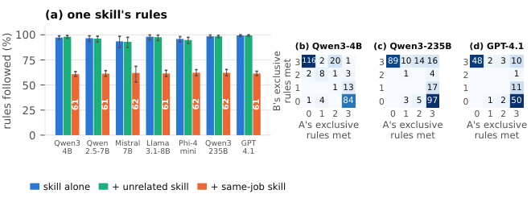

# One Skill Takes Over: Clashing Agent Skills and a One-File Fix

> University of Southern California · 2026-10-20 · paper · **支撑·无闭环** · [论文](https://arxiv.org/abs/2610.25064) · [仓库](https://github.com/prazmara/skillclash)
> 机制族：技能文件优化与技能库 · 来源核验 2026-10-21 · 复现状态 not-run

## Pipeline

对技能干扰的实证解剖。SkillClash 含 16 对同职能技能，规则由代码校验并给出最佳可达参照输出；把两份同职能技能装入同一上下文会出现“接管”——输出遵循其一技能的全部独占规则、丢弃另一个——由文件内的示例驱动。测试的修复：告知模型哪个技能优先（救不回被丢技能）、要求两个都执行（仅对两个最强模型有效）、在每份文件末尾放一个共享的正确示例（六模型上接管率降到 1-15%）、以及由 Claude Opus 5.5 写的单文件合并元技能。

*图源：Figure 2 (fig_takeover.png), arXiv HTML 2610.25064v1*
## 结果（作者报告，非本地复现）

五个家族的七个模型（4B 开源到 Qwen3-235B 与 GPT-4.1）上，技能单独加载时规则遵循 93-99%，并排装入同职能技能后降至 61-62%；合并文件在全部七模型上恢复 96-99% 可达规则（68-94% 输出完全正确），其中正确的示例单独就值 +12-17 点——错误示例几乎无增益。

## 证据边界

仅指令文件技能（不含工具/技能脚本）；16 个规则可代码校验的职能对；最强合并由循环外的前沿模型写出而非演化得到；同职能配对可能高估松散相关技能间的冲突。

## 对 nanoRSI 的输入

多技能工作区的技能模板卫生：运行前审计活跃技能文件的同职能规则重叠（冲突检查）；发现重叠时要求共享正确示例或合并为单文件——这是技能线一个廉价的前置检查，与本仓库每工作区技能面直接对应。

## 来源

[arXiv abs 2610.25064](https://arxiv.org/abs/2610.25064) · [arXiv HTML v1](https://arxiv.org/html/2610.25064v1) · [prazmara/skillclash (no license file)](https://github.com/prazmara/skillclash)
