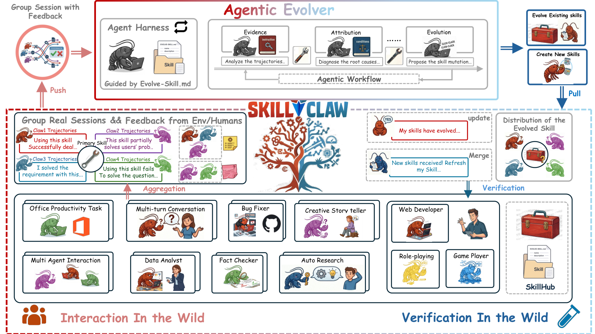

# SkillClaw: Let Skills Evolve Collectively with Agentic Evolver

> Alibaba (Amap DreamX Team) · 2026-04 · paper · **闭环** · [论文](https://arxiv.org/abs/2604.08377) · [仓库](https://github.com/AMAP-ML/SkillClaw)
> 机制族：技能文件优化与技能库 · 来源核验 2026-09-16 · 复现状态 not-run

## Pipeline

跨用户群体的技能集体进化：跨用户会话变成保留完整'动作-反馈'因果链的结构化轨迹；会话按所引用的技能分组（天然消融，隔离每个技能的影响）；智能体进化器分析成败模式后选择精炼/新建/跳过；候选更新夜间在空闲用户环境验证，只有通过验证的改进才合并并同步给全部智能体（交互 -> 证据 -> 进化 -> 验证 -> 部署）。

*图源：Figure 1*
## 结果（作者报告，非本地复现）

WildClawBench（Qwen3-Max 骨干、8 个模拟用户、6 天；报告六个类别中四个）：社交互动 54.01% -> 60.34%（+6.33）、搜索检索 22.73% -> 34.55%（+11.82，相对 +52%）、创意合成 11.57% -> 21.80%（相对 +88.41%）、安全对齐 24.00% -> 32.00%。受控'Skill Evolve Lite'探针：保存报告 28.3% -> 100.0%；平均 30.4% -> 72.5%。增益相对第 1 天初始技能集，非外部系统。

## 证据边界

作者自述小规模测试（用户、反馈信号、交互深度有限）；结果仅覆盖六类中四类；后期大量候选被拒（6 天内进化进入平台期）；验证增加 token 成本。

## 对 nanoRSI 的输入

对 nanoRSI：先按'调用过的技能'给执行证据分组再做归因——按技能分桶的会话是无须额外消融运行的最廉价因果隔离。

## 来源

[arXiv abstract](https://arxiv.org/abs/2604.08377) · [Paper v1 (Figure 1, results)](https://arxiv.org/html/2604.08377v1) · [Code repository (MIT)](https://github.com/AMAP-ML/SkillClaw)
