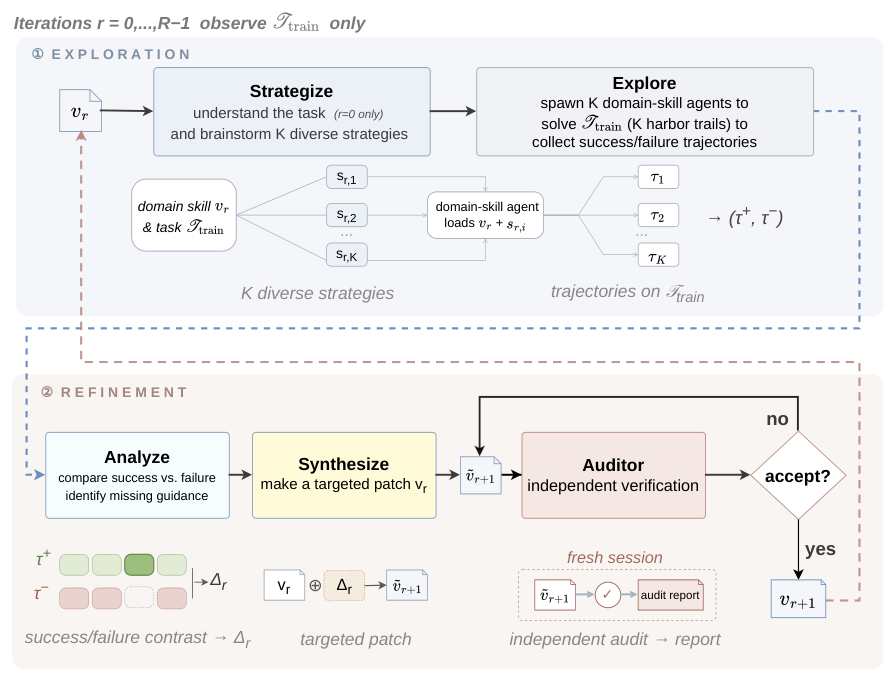

# SkillEvolver: Skill Learning as a Meta-Skill

> Tsinghua University / Beijing Jiaotong University · 2026-05-11 · paper · **闭环** · [论文](https://arxiv.org/abs/2605.10500) · [仓库](https://github.com/THU-AICosmos/skillevolver)
> 机制族：技能文件优化与技能库 · 来源核验 2026-09-15 · 复现状态 not-run

## Pipeline

技能自进化被封装为任何遵循协议的 CLI 智能体都能加载的“元技能”；只更新技能的文本与代码，不动模型权重。单轮迭代：构思并派生 K 个策略多样的领域技能智能体收集成败轨迹；对比分析并合成针对性技能补丁；随后由全新会话中的独立审计员验证补丁——新鲜智能体过拟合审计，可发现数据泄漏与“静默旁路”（技能看似有效但运行时从未被调用）。只有部署后才触发精炼，学习信号来自真实下游智能体踩到的失败，而非仅探索轨迹。

*图源：Figure 2*
## 结果（作者报告，非本地复现）

SkillsBench（83 任务、15+ 领域）：56.8% avg@5，对比人工精选技能 43.6%、无技能 29.9%；官方仓库 README 载明 R=2 配置达 56.9%，进化技能在 74.7% 的任务上持平或超过人工精选。KernelBench GPU 核优化：H100 上平均加速比 1.16 提至 1.51。下游运行 token -19%、轮次 -15%、墙钟 -24%；端到端成本约每任务 4 美元（仓库 README）。

## 证据边界

基准采用作者自定任务范围；“先部署后精炼”的信号假定其他智能体会复用技能库，冷启动情形不明；成本与逐任务数字来自仓库 README 而非论文正文。

## 对 nanoRSI 的输入

把“新鲜智能体过拟合审计 + 静默旁路检查”采纳为 nanoRSI 的技能验收闸门：用无任何先前会话状态的智能体审计候选技能，同时检验泄漏与运行时是否真的调用该技能。

## 来源

[arXiv abstract](https://arxiv.org/abs/2605.10500) · [Paper v1 (affiliations, Figure 2, Tables 1-2)](https://arxiv.org/html/2605.10500v1) · [Official code repository (MIT)](https://github.com/THU-AICosmos/skillevolver)
