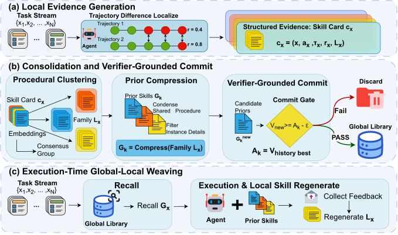

# SkillGLoW: Procedural-Family Skill Consolidation for Self-Improving Agents on Long-Horizon Task Streams

> National University of Singapore / Institute of Advanced Intelligence and Computing (IAIC), Singapore · 2026-09-02 · paper · **闭环** · [论文](https://arxiv.org/abs/2609.02217)
> 机制族：技能文件优化与技能库 · 来源核验 2026-09-15 · 复现状态 not-run

## Pipeline

每个任务的执行产出本地技能卡；基于嵌入的聚类把卡片聚成程序性家族，压缩器把每个家族压成去实例化的全局先验。验证器锚定的提交闸门只在真实下游执行证明先验不会降低已部署技能库表现时才准入（与历史最优值比较）。执行时把冻结先验与即时再生成本地技能编织使用，实例细节按任务再生而非存储。

*图源：Figure 2*
## 结果（作者报告，非本地复现）

在跨 4 个基准（数学推理、终端自动化、软件修复、具身 ALFWorld）、3 个模型的 12 次持续改进运行中，整合先验相对无技能基线平均 +17.2 hard 分（本地再生后 +18.0），12/12 次运行全部为正。先验库比逐任务池紧凑 3.6 倍，并在 21 格中的 15 格领先一个已发表的单文档优化器。不加修改的先验把未见 ALFWorld 成功率从 73.9% 提到 83.9%。

## 证据边界

未发布代码与数据；与单文档优化器的对比是附录中对齐任务集、模型与提示后的重跑，所有数字来自作者自测。作者也报告了随模型家族变化的波动。

## 对 nanoRSI 的输入

对 nanoRSI 技能库：把相关任务聚成家族并按家族压缩先验，而非维护单一全局文档；并要求真实执行提交闸门——只有当前技能库分数不退化时才准入候选先验。

## 来源

[arXiv abstract](https://arxiv.org/abs/2609.02217) · [Paper v1 (affiliations, Figure 2, Tables 1-4)](https://arxiv.org/html/2609.02217v1)
