# Skill$^{\infty}$: 自指技能优化（meta-skill 递归重写自身与任务技能）

> （机构以论文作者块为准） · 2026-10-26 · paper · **闭环** · [论文](https://arxiv.org/abs/2610.35434)
> 机制族：技能文件优化与技能库（手写深记） · 来源核验 2026-10-29 · 复现状态 not-run（官方仓库仅 README/LICENSE，代码"coming soon"）

## Pipeline

一个 agent 主导的优化流程本身被编码为标准 **meta-skill**（SKILL.md 包 + 参考资料 + 脚本）。meta 智能体按该 meta-skill 行动来优化任务技能：诊断执行轨迹 → 提出候选 → 独立评审 → 自适应分配搜索预算。关键的自指一步：**同一流程被作用于 meta-skill 自身**——在"技能优化任务"上评估（以相对种子任务技能的增益为分），于是自我改进可以重写优化流程的任何部分，包括指令、脚本乃至评审/选择规则；只有打分规则被排除（防奖励篡改）。meta-skill 与任务技能解耦：前者跨多领域精炼一次、到处复用；两级技能都通过原生技能发现加载而非提示注入。

*图源：Figure 1 内联 SVG（arXiv HTML 2610.35434v1，LaTeXML 生成）；文字要素与论文图注一致，框线布局在本地渲染下不完整，以论文原文图为准*

## 结果（作者报告，非本地复现）

- SkillsBench（83 任务，avg@5）：Skill∞ **60.7%** 对人工精选 56.4%、SkillEvolver 54.5%、无技能 45.5%；**关掉自我改进降至 55.9%**（自指增益约 +4.8 点）。
- KernelBench：平均加速 1.62× 对 SkillEvolver 1.18×、无技能 1.02×。
- 跨模型泛化：GPT-5.6 Luna 66.5%、OpenCode 56.9%，均胜人工精选。
- 成本：单任务技能优化约 8.7M input tokens；自我改进摊薄后开销 <15%。

## 证据边界

**代码未发布**（仓库"Code: Coming Soon"），全部数字为作者报告。SkillsBench 83 任务为中等规模；"技能优化任务"的评分定义（对种子技能的增益）由作者设计，meta-skill 可能在该代理指标上过拟合；跨模型只测了两个前端模型。自指改写排除了打分规则，但评审/选择规则仍在可改面内——评审漂移的长期行为未报告。

## 对 nanoRSI 的输入

与 v0.5 的技能面（skills/<slug>/SKILL.md）天然契合：把"改任务技能的流程"和"改流程自身的流程"分成**两个可审计的版本流**（对应 meta-skill 与 task-skill），在匹配 token、冻结留出集与父代同场重测下比较——而不是启用递归 meta 默认行为。论文的"排除打分规则"与我们的"分数永不进选择"同源；"关掉自我改进"的消融列（55.9 对 60.7）正是我们评估任何递归组件时该报告的标准列。

## 来源

[arXiv abs 2610.35434](https://arxiv.org/abs/2610.35434) · [arXiv HTML v1](https://arxiv.org/html/2610.35434v1) · [官方仓库（代码未发布）](https://github.com/taowangcheng/skill-infinity)
