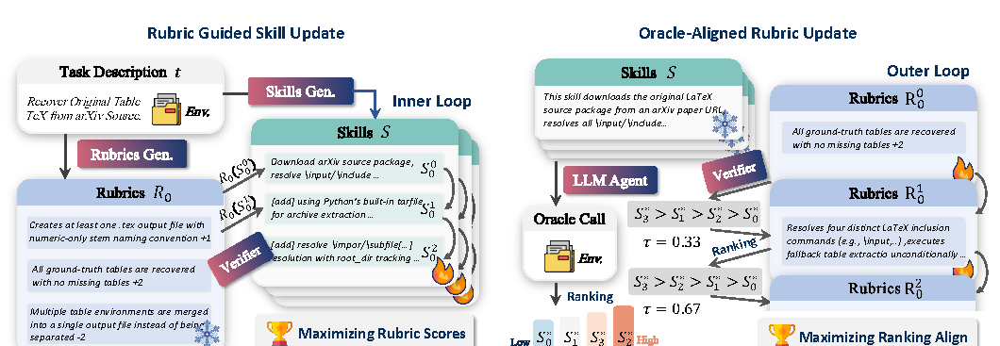

# SkillLift: Learning Dense Rubrics from Sparse Oracles for Efficient Skill Evolution

> Independent Researcher (Haoxiang Kang) / Fudan University (Ming Wen) · 2026-09-14 · paper · **闭环** · [论文](https://arxiv.org/abs/2609.15396) · [仓库](https://github.com/WalteR-MittY-pro/SkillLift)
> 机制族：技能文件优化与技能库 · 来源核验 2026-09-16 · 复现状态 not-run

## Pipeline

把技能自进化重构为双层优化，以摆脱 oracle-rollout 瓶颈（通常每个候选编辑都要跑一整次智能体 rollout）。学习一个结构化评分表 R——对技能行为的 M 条带符号权重的二元判据——作为廉价的 oracle 对齐替代器。内环：冻结 R 引导技能修订，用一次 LLM 调用而非 rollout 为候选打分。外环：在冻结技能上跑少量 oracle rollout，用 Kendall's tau 秩相关重对齐 R——只看相对次序，不校准绝对分值。交替循环在保持替代器可信的同时摊薄 oracle 成本。

*图源：Figure 2, PDF page 3*
## 结果（作者报告，非本地复现）

在 WildClawBench 与 SkillsBench、三个骨干模型上（SkillsBench 用 GPT-5.4-mini、WildClawBench 用 GPT-5.4，与官方实现对齐），SkillLift 同时超过人工技能、一次性 LLM 技能、SkillOpt 与 CoEvoSkills，且 token 成本比前沿进化方法省 40-70%。表 2 分类别格显示：各组内对最强基线的总分区间为 WildClawBench +5.4~+14.0、SkillsBench +9.6~+28.3；先导实验表明直接 oracle 引导搜索的累积 token 被 oracle rollout 成本主导。

## 证据边界

两人署名论文；基准类别与评分表质量依赖 oracle 存在且可排序。基线获得 2 倍于 SkillLift 默认预算的 token，成本对比对此有利。全部数字为作者自测；仓库很新（核验时 2 星）。

## 对 nanoRSI 的输入

对 nanoRSI 技能环：用学习的评分表替代器替换逐编辑全 rollout，周期性用秩相关在 oracle rollout 上重对齐——可在最小任务上直接验证其为更便宜的技能验收信号。

## 来源

[arXiv abstract](https://arxiv.org/abs/2609.15396) · [Paper v1 PDF (affiliations, Figure 2, Table 2, protocol)](https://arxiv.org/pdf/2609.15396) · [Code repository (MIT)](https://github.com/WalteR-MittY-pro/SkillLift)
