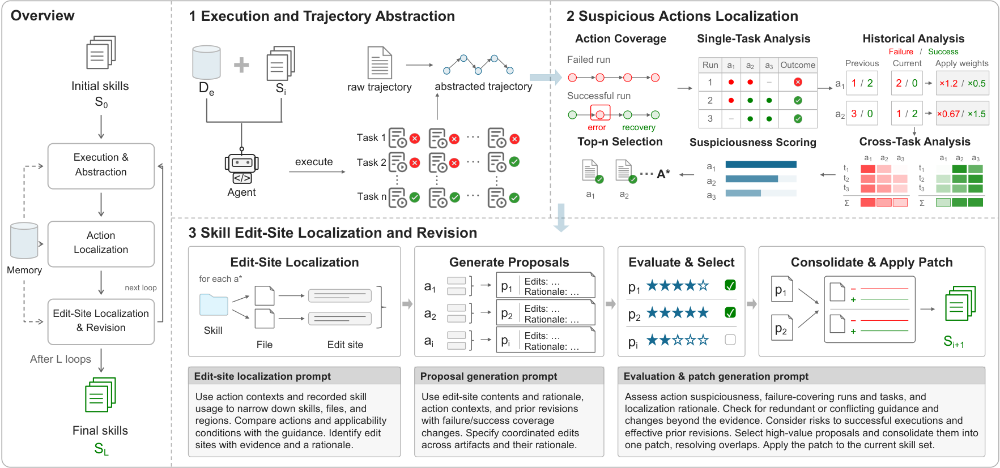

# Trajectory-Guided Fault Localization for Agent Skill Evolution

> Nanjing University / The Hong Kong Polytechnic University · 2026-10-08 · paper · **闭环** · [论文](https://arxiv.org/abs/2610.11858)
> 机制族：技能文件优化与技能库 · 来源核验 2026-10-12 · 复现状态 not-run

## Pipeline

SkillMorph 把技能修订锚定在行为证据上：抽象化执行轨迹，跨重复运行与任务比较失败与成功证据，用演化循环之间的差异定位可疑动作，再在相应技能内定位编辑点并生成针对性修订——而不是仅凭结果反馈重写整条技能。

*图源：Figure 3 (overview-final.png): SkillMorph overview - trajectory abstraction, failure/success comparison, suspicious-action ranking and localized skill revision*
## 结果（作者报告，非本地复现）

在 490 个 SWE-Skills-Bench 任务（1,470 次运行）上：SkillMorph 95.51% pass@3 / 92.24% 逐试精度 / 88.37% pass3，对照原始技能 82.45/75.44/67.96、四个技能演化基线中最强的 CAP-Evolve 92.24/89.39/84.90。在 15 个任务的 CannBot AscendC 内核基准上：三项指标均为 93.33，对照原始技能 80.00/66.67/46.67、CAP-Evolve 93.33/84.44/73.33。消融：去掉定位后 SWE 总体降至 91.22/87.35/82.24；单次运行变体 90.20。内核生成部署产生的 6 个技能修订拉取请求被开发团队接受。

## 证据边界

未找到公开代码、基准或技能语料（HTML 中的 GitHub 链接指向 cap-evolve 等基线）；CannBot 仅 15 个任务，93.33 的天花板落在小面板上；逐试精度与 pass@3 由作者自己的 harness 计算；6 个被接受的 PR 作为落地证据计数，未对算子质量做受控前后对照。

## 对 nanoRSI 的输入

nanoRSI 技能轨道可检验的思路：重写技能前，先对重复运行的抽象化失败/成功轨迹做差异对比，对可疑动作排序，并把编辑限制在这些动作回溯到的技能区域——与同评测预算下的整技能重写对照，并把编辑点精确率作为诚实的附加指标报告。

## 来源

[arXiv abstract](https://arxiv.org/abs/2610.11858) · [arXiv HTML v1](https://arxiv.org/html/2610.11858v1)
