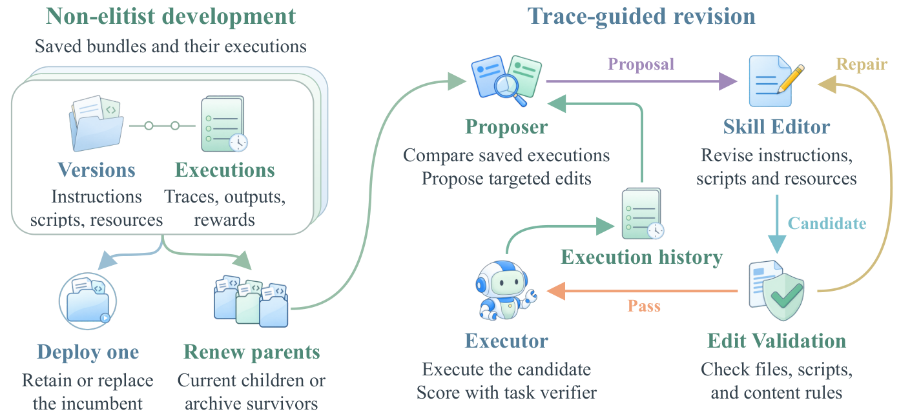

# SkillNEO: Non-Elitist Evolutionary Optimization of Agent Skills

> University of Illinois at Chicago / Mohamed bin Zayed University of Artificial Intelligence / University of California, San Diego / University of California, Los Angeles / University of Texas at Arlington 等 · 2026-10-15 · paper · **闭环** · [论文](https://arxiv.org/abs/2610.20926)
> 机制族：技能文件优化与技能库 · 来源核验 2026-10-17 · 复现状态 not-run

## Pipeline

非精英技能演化：把“选哪个版本来用”与“选哪些版本继续改”分开——提升可能需要多条相互依赖的编辑，低分修订仍可能带有可用部分。通过观察相关版本如何执行同一任务，识别应保留的可用步骤与待修复的残留失败；还能回到更早版本，用后续尝试揭示的信息重新修订。

*图源：Figure 2 (skillneo_method_artwork.png), arXiv HTML 2610.20926v1*
## 结果（作者报告，非本地复现）

在覆盖软件工程、办公与另外六个领域的 86 个 SkillsBench 任务上，SkillNEO 把 GPT-5.4 Mini 的平均奖励从 49.1% 提到 66.4%，进入 GPT-5.5 与 GPT-5.6 Luna 的原技能性能区间。演化出的技能无需再编辑即可改进更强模型：在有改动的 41 个任务上，复用使 Luna 提升 10.5 个百分点、GPT-5.5 高出其公开原技能参考 10.6 个百分点。

## 证据边界

HTML 未找到 SkillNEO 本体的代码 URL（只有 SkillsBench 轨迹数据链接）；评测在作者自建的 SkillsBench 套件上；增益集中在较弱的编辑模型上，迁移在 41 任务子集上测得。

## 对 nanoRSI 的输入

“用与改”分离的非精英选择是 ADOPTION 53 缺的另一半：让低分版本保持可编辑（但绝不投入使用）能抓住严格闸门丢弃的相互依赖编辑收益——与同批次 AtomSearch 的“保留但不晋升”状态互补（不同团队独立得出）。向更强模型 +10.5 个百分点的向上迁移，是技能面对我们跨面板迁移问题的回答。

## 来源

[arXiv abs 2610.20926](https://arxiv.org/abs/2610.20926) · [HTML full text v1](https://arxiv.org/html/2610.20926v1)
