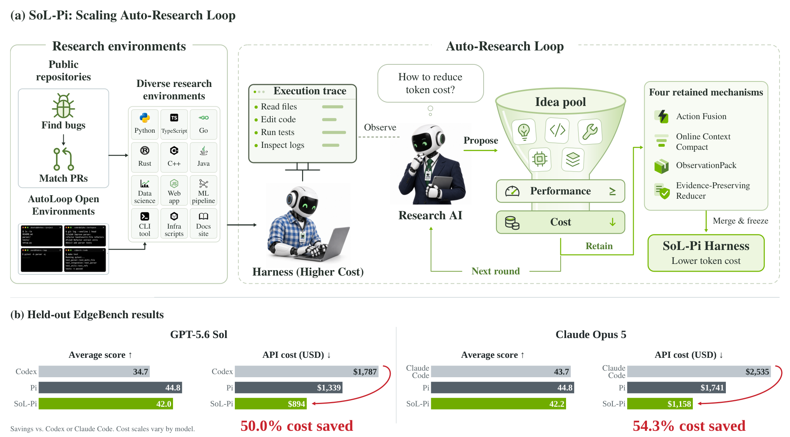

# SoL-Pi: Recursively Scaling Auto-Research Loops for Efficient Agent Harness

> NVIDIA / Nanyang Technological University / MIT · 2026-09-17 · paper · **闭环** · [论文](https://arxiv.org/abs/2609.20519) · [仓库](https://github.com/NVlabs/SoL-Pi)
> 机制族：自改写元智能体与谱系 · 来源核验 2026-09-19 · 复现状态 not-run

## Pipeline

受 RSI 启发的自动研究循环递归改进 agent harness 本身：研究 AI 从执行轨迹提出 harness 机制，agent 种群并行探索候选并独立评审，只有通过留出验证的机制被保留（EdgeBench 始终不进搜索）——最终保留四个机制。

*图源：Figure 1 (teaser-funnel-v10.png)*
## 结果（作者报告，非本地复现）

在 51 任务 EdgeBench 上，SoL-Pi 在 GPT-5.6 Sol 与 Opus 5 下性能与 Pi 持平，token 流量降 44.7-49.0%、API 成本约降三分之一；相对原生 Codex/Claude Code 每小时省 $8.75-13.50，相对 Pi 省 $4.36-5.71。

## 证据边界

作者自报的等性能效率增益；搜索本身耗算力不小（两小时种群运行）；EdgeBench 类边缘任务之外的泛化未展示。

## 对 nanoRSI 的输入

仓库衍生搜索环境与永不触碰的留出基准之间的硬隔离，加上机制保留前的独立评审闸门，可直接移植到 nanoRSI 种群运行。

## 来源

[arXiv abstract](https://arxiv.org/abs/2609.20519) · [Paper HTML (affiliations, Figure 1-2, abstract numbers)](https://arxiv.org/html/2609.20519v1) · [Code repository](https://github.com/NVlabs/SoL-Pi) · [Project page](https://nvlabs.github.io/SoL-Pi/)
