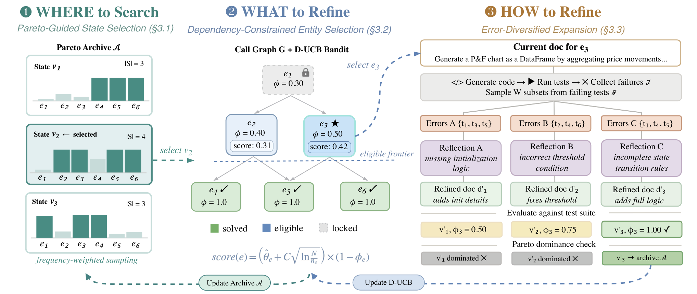

# SpecForge: Recursive Self-Improvement for Coding Agents via Behavioral Specifications

> Virginia Tech / NEC Laboratories America · 2026-10-11 · paper · **闭环** · [论文](https://arxiv.org/abs/2610.15708) · [仓库](https://github.com/ccsnow127/SpecForge)
> 机制族：结构化知识库与图 · 来源核验 2026-10-16 · 复现状态 not-run

## Pipeline

改进外部上下文而非权重：代理按当前程序实体的自然语言行为规约生成代码，跑执行验证的测试（由参考实现生成、仅保留通过者），并从失败中修订规约。输出耦合——改好一个实体的规约可能劣化依赖者（“打地鼠”）——由多前沿树搜索应对：(i) 帕累托引导的状态选择维护逐实体通过率向量上非支配状态的档案，按频率加权采样扩展节点；(ii) 依赖约束的实体选择要求实体未解决且全部被调用方已解决（先被调后调用），用折扣 UCB 老虎机按归一化缺口闭合奖励分配预算；(iii) 误差多样化扩展每步生成 W=3 个子节点，各以随机约半数失败测试子集为条件做 Diagnose→Prescribe，再整体重生成并全量重测。

*图源：Figure 2 (S3.F2), arXiv HTML v1*
## 结果（作者报告，非本地复现）

DevEval+ 五骨干：88.9（Qwen3-235B-A22B）、89.6（Gemini-2.5-Flash）、90.9（GPT-4o）、91.0（Gemini-3.1-Pro）、94.9（Claude-4.5-Sonnet）；平均较最强基线 DocSearch（作者自己的 ICML 2026 playbook 优化器）+5.7 个百分点。迁移：DevEval+-Java 65.7% 对仅源码 39.7%（规约+源码 76.2%）；SWE-Dev 新特性实现 74.5% easy / 51.7% hard Pass@1 对基准 PRD 的 55.7 / 44.6。消融：逆拓扑序 −18.6%、D-UCB −10.4%、误差多样性 −9.5%、帕累托档案 −5.2%。

## 证据边界

静态文档在跨语言迁移上不如仅源码；GEPA 达峰后下滑；DocSearch 在修订基准上掉约 5.6 分。存在局限性附录章节但其内容未在抓取的 HTML 中渲染。HTML 邮箱-作者映射互换（已记入机构字段）。

## 对 nanoRSI 的输入

三个可直接迁移点：按实体维护非支配的技能/规约变体帕累托档案而非单一现任者（支配关系定义在逐条目通过率向量上）；演化多文件技能束时强制先被调后调用的编辑顺序；让提案器的每次尝试以观测失败的不同子集为条件（误差多样化扩展），使种群子代搜索不同前沿。

## 来源

[arXiv abstract](https://arxiv.org/abs/2610.15708) · [arXiv HTML v1](https://arxiv.org/html/2610.15708v1) · [SpecForge code](https://github.com/ccsnow127/SpecForge)
