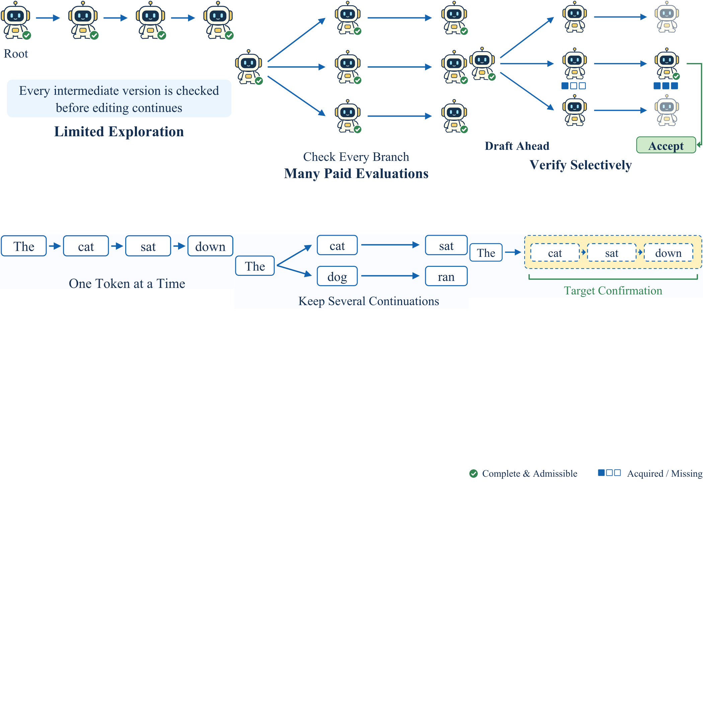

# Drafting Agents, Not Just Tokens: Speculative Recursive Self-Improvement for Agentic Systems

> Tencent AMS / Peking University / Beihang University / Xiaohongshu / University of Chinese Academy of Sciences 等 · 2026-10-12 · paper · **闭环** · [论文](https://arxiv.org/abs/2610.16491) · [仓库](https://github.com/SpecRSI-GPR/SpecRSI)
> 机制族：自改写元智能体与谱系 · 来源核验 2026-10-15 · 复现状态 not-run

## Pipeline

把投机执行引入递归自改进：在父代验证完成前就起草可执行的子代 agent，长出一棵由冻结版本与编辑边组成的不可变树；采纳仍要求完整、可采纳的验证。VATS（验证感知树搜索）在起草与检查之间分配剩余预算——Solver 用 MILP（缺失检查、依赖、共享设置）构造可行补全束，Scorer 预测扣除未来成本后的期望已验证增益，Policy 采样下一个起草或验证计划。GVO（组验证优化）进而训练改进器本身：同一根节点在冻结改进器下跑 G>=2 次独立完整搜索，优势=每次搜索的已验证增益减全部成本对组内留一均值，Scorer 以实现后缀回报回归+成对差分损失训练，演员用裁剪 PPO 式目标更新；验证契约全程冻结。

*图源：Figure 1 (six panel SVGs trim_f1a-f1f + legend, recomposed into one image): single-path RSI, parallel branches and speculative RSI mapped to greedy, beam search and speculative decoding*
## 结果（作者报告，非本地复现）

科学赛道：50 个骨干-任务对全胜 Janus，终局增益 +33.3-40.0%、AUBC +30.4-33.7%（逐对提升 17.8-27.6%）。系统赛道：20 个骨干上宏平均超 MetaRSI-v1 1.85-2.38pp（TB2.1、SWE-Pro、GPQA-hard100、AIME）。编码验证 69.4% 对 HGM 64.3%，成本指数低 20.8%（60.8 对 76.8）。生命周期总成本指数 106.3 对 MetaRSI-v1 的 112.7；科学搜索成本比 Janus 高 7.2%——诚实注脚是投机买到的是出结果时间，不是处处更便宜。

## 证据边界

科学搜索成本比 Janus 高约 7%；部分 10 骨干图上总成本指数比 MetaRSI-v1 高 0.83-0.90%；基线是近期预印本系统（Janus、MetaRSI-v1、HGM）而非成熟排行榜；验证契约固定意味着验证器本身未被改进。

## 对 nanoRSI 的输入

两个可迁移件：(1) 只认完整验证的投机起草是 nanoRSI 尝试循环的预算策略——当前提案面板未跑完就先起草下一个，但绝不在部分证据上晋升；(2) GVO 的组内多次搜索+留一优势+冻结改进器正是 ADOPTION 第 38 项控制下的'改进改进器'探针（冻结改进器、等预算、只认已验证增益）。

## 来源

[arXiv abstract](https://arxiv.org/abs/2610.16491) · [arXiv HTML v1](https://arxiv.org/html/2610.16491v1) · [SpecRSI-GPR/SpecRSI (MIT)](https://github.com/SpecRSI-GPR/SpecRSI)
