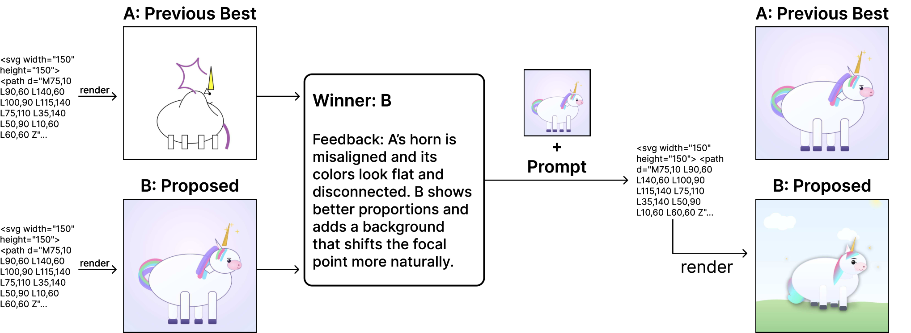

# Feedback Descent: Open-Ended Text Optimization via Pairwise Comparison

> Stanford University · 2025-11-11 · paper · **闭环** · [论文](https://arxiv.org/abs/2511.07919)
> 机制族：反馈审查与编排 · 来源核验 2026-09-16 · 复现状态 not-run

## Pipeline

对成对比较的文本批评充当高带宽'类梯度'监督，完全在推理期编辑文本工件，不改权重。每轮：在累积反馈与当前最优条件下提议改进工件；评估器返回二元偏好 + 文本理由；理由即启发式改进方向。理论：若反馈方向平均与真实梯度正相关，收敛与维度无关且为线性。

*图源：Figure 1*
## 结果（作者报告，非本地复现）

提示优化（Qwen3-8B）：四任务全胜 GRPO（如 Hover 60.00 对 38.67），与 GEPA 互有胜负（Hover 60.00 对 52.33）。分子优化（DOCKSTRING）：六个靶点全部超过约 26 万化合物库的第 99.9 百分位（如 ADRB1 10.623 对阈值 10.209），胜 REINVENT 与 TextGrad。

## 证据边界

依赖强评估器（某些领域稀缺）；创意领域严格'沿梯度走'可能限制探索。

## 对 nanoRSI 的输入

对 nanoRSI：无数值 oracle 时，把标量验收换成'偏好 + 理由'对——理由成为下一次提议的复用反馈记忆，即文本空间的梯度类似物。

## 来源

[arXiv abstract](https://arxiv.org/abs/2511.07919) · [Paper v1 (affiliations, Figure 1, Tables 2-3)](https://arxiv.org/html/2511.07919v1)
