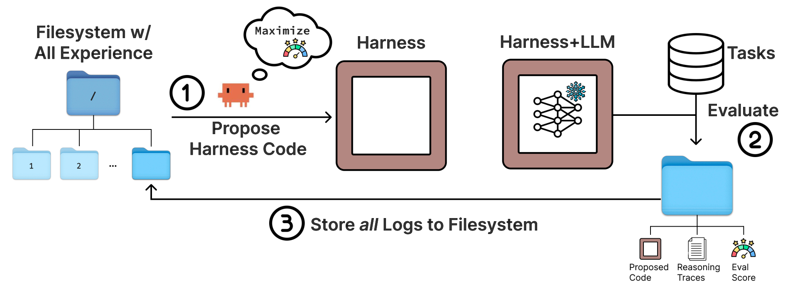

# Meta-Harness: End-to-End Optimization of Model Harnesses

> Stanford University / MIT / KRAFTON · 2026-03 · paper · **闭环** · [论文](https://arxiv.org/abs/2603.28052) · [仓库](https://github.com/stanford-iris-lab/meta-harness-tbench2-artifact)
> 机制族：Harness 搜索与进化 · 来源核验 2026-09-16 · 复现状态 not-run

## Pipeline

对任务 harness 代码的外层搜索环：编码智能体提案者（Claude Code / Opus 4.6）读取一个持续增长的文件系统——内含此前每个候选的源码、执行轨迹与分数（经 grep/cat 工具）——提议新的单文件 harness（控制提示、检索、记忆与编排），评估后把全部信息写入新目录。用精度-上下文成本的 Pareto 前沿取代硬编码父代选择；20 轮迭代约 60 个 harness。消融：完整轨迹访问是关键——只看分数时最优精度从 56.7 塌到 41.3，轨迹摘要甚至有害。

*图源：Figure 2*
## 结果（作者报告，非本地复现）

TerminalBench-2（Opus 4.6）：76.4%（Opus-4.6 智能体中排名第二；Terminus-KIRA 74.7%；ForgeCode 更高的 81.8% 用公开代码无法复现）。Haiku 4.5：37.6%，第一。文本分类：11.4K 上下文 token 下 48.6%，对 ACE 50.8K 下的 40.9%（+7.9 且省 4 倍 token）；OOD 73.1% 对 70.2%；以 0.1 倍评估次数追平此前最优文本优化器。

## 证据边界

TerminalBench-2 的搜索与最终评估用同一批 89 个任务（'发现问题'设定），仅靠人工检查与正则审计查字符串泄漏；只研究了一个提案智能体；ForgeCode 榜单分无法复现。

## 对 nanoRSI 的输入

对 nanoRSI：把每个候选的完整轨迹（而非摘要）存入提案者可查询的存储——消融表明让 harness 搜索奏效的是轨迹访问本身，而非选择策略的精巧。

## 来源

[arXiv abstract](https://arxiv.org/abs/2603.28052) · [Paper v1 (affiliations, Figure 2, results)](https://arxiv.org/html/2603.28052v1) · [Artifact repository](https://github.com/stanford-iris-lab/meta-harness-tbench2-artifact)
