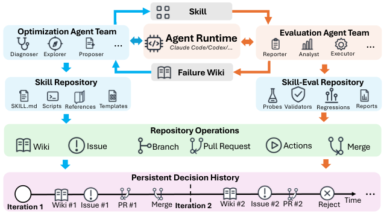

# SkillHone: A Harness for Continual Agent Skill Evolution Through Persistent Decision History

> WeChat, Tencent Inc. · 2026-06-07 · paper · **闭环** · [论文](https://arxiv.org/abs/2606.08671) · [仓库](https://github.com/Tencent/SkillHone)
> 机制族：技能文件优化与技能库 · 来源核验 2026-09-13 · 复现状态 not-run

## Pipeline

持久决策历史保存诊断、候选技能修订、脱敏评测证据和结果。优化 Agent 与评测 Agent 分别操作技能仓库和评测仓库；被接受的修订进入后续会话，因此技能产物在迭代间被修改并复用。

*图源：Figure 2, framework.png*
## 结果（作者报告，非本地复现）

在 Qwen3.6-35B-A3B 的开放网页设置中，SkillHone 报告 GAIA 平均 64.6，对比精心构建的深度研究 Agent 48.8（+15.8）；WebWalkerQA-EN 为 66.4，对比 63.2（+3.2）。内部工具场景报告平均提升 +18.8；这些是作者报告的、任务特定的结果。

## 证据边界

论文主要评测英文基准，并一次隔离一个技能；尚未展示多技能联合进化。原始企业内部框架不等同于公开仓库，因此不应把开源包写成腾讯内部基础设施的完整发布。

## 对 nanoRSI 的输入

为 nanoRSI 增加版本化技能目录：保存决策记录、候选 diff、评测证据和回滚决定，再在隐藏任务上比较固定技能与接受修订后的复用。

## 来源

[arXiv first submission and history](https://arxiv.org/abs/2606.08671) · [Paper v1 and framework figure](https://arxiv.org/html/2606.08671v1) · [Tencent SkillHone repository](https://github.com/Tencent/SkillHone) · [SkillHone MIT license](https://github.com/Tencent/SkillHone/blob/main/LICENSE)
