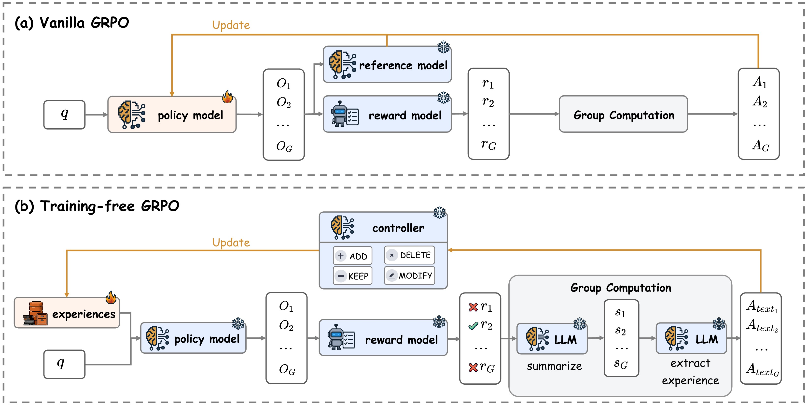

# Training-Free Group Relative Policy Optimization

> Tencent Youtu Lab / Fudan University / Xiamen University · 2025-10-09 · paper · **闭环** · [论文](https://arxiv.org/abs/2510.08191) · [仓库](https://github.com/TencentCloudADP/youtu-agent/tree/training_free_GRPO)
> 机制族：经验积累与回放 · 来源核验 2026-09-13 · 复现状态 not-run

## Pipeline

冻结的基础模型生成分组 rollout，将语义优势蒸馏到会演化的经验库和 token 先验中，再通过上下文回馈而非梯度更新。多个 epoch 共享累积经验，参数保持不变但后续输出分布发生变化。

*图源：Figure 2, training-free_GRPO.png*
## 结果（作者报告，非本地复现）

在 DeepSeek-V3.1-Terminus 上，直接提示的 AIME24 从 68.6 提升到 72.6（+4.0），AIME25 从 52.9 到 54.0（+1.1）；ReAct+CI 的 AIME24 为 80.0→82.7（+2.7），AIME25 为 67.9→73.3（+5.4），论文报告成本为 18 美元。论文设置下 WebWalkerQA 为 63.2→67.8（+4.6）。

## 证据边界

这是上下文空间的经验进化，不是参数训练：基础模型冻结，变化的是经验库。结果依赖有界分组、重试和任务特定提示；论文未展示改进器自主重设计自身算法。

## 对 nanoRSI 的输入

为 nanoRSI 记忆实验增加冻结模型对照：在相同分组数量下比较无经验库、固定经验库和递归刷新经验，并记录 token 成本、过时建议和隐藏集迁移。

## 来源

[arXiv first submission and history](https://arxiv.org/abs/2510.08191) · [Paper v1 and Training-Free GRPO figure](https://arxiv.org/html/2510.08191v1) · [Official Youtu-Agent implementation](https://github.com/TencentCloudADP/youtu-agent/tree/training_free_GRPO) · [Youtu-Agent MIT license](https://github.com/TencentCloudADP/youtu-agent/blob/main/LICENSE)
