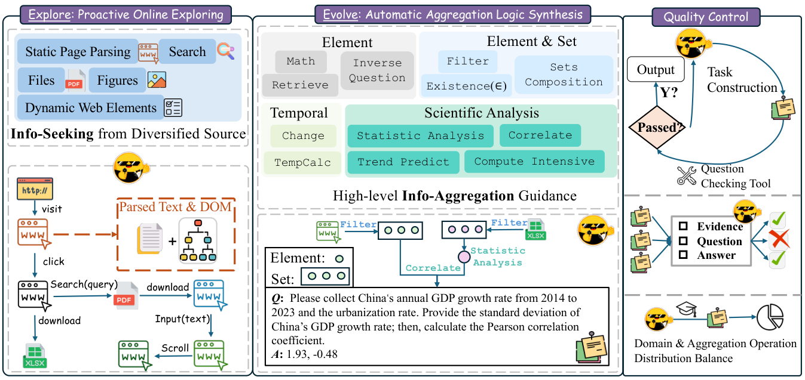

# WebAggregator: Enhancing Compositional Reasoning Capabilities of Deep Research Agent Foundation Models

> Tencent AI Lab / The Chinese University of Hong Kong · 2025-10-16 · paper · **闭环** · [论文](https://arxiv.org/abs/2510.14438) · [仓库](https://github.com/Tencent/WebAggregator)
> 机制族：程序进化与进化搜索 · 来源核验 2026-09-13 · 复现状态 not-run

## Pipeline

在线探索器访问网页，组合逻辑提案器选择、组合并细化高层聚合操作。质量控制将可执行聚合程序转成覆盖 5 万网站、11 个领域的 1 万条可验证 QA；轨迹与答案再用于 WebAggregator 模型的 SFT。

*图源：Figure 2, illus.png*
## 结果（作者报告，非本地复现）

论文报告 WebAggregator-8B 达到 GPT-4.1 水平，32B 在 GAIA-text 上超过 GPT-4.1 十个百分点以上并接近 Claude-3.7。人工标注的 WebAggregatorQA 测试中，Claude-3.7 的 pass@1 为 28.0%，GPT-4.1 为 25.8%；模型比较使用固定裁判和有界重试。

## 证据边界

被进化的对象是网页聚合程序及其生成训练数据；下游基础模型经过 SFT 后评测，并未递归部署来改进自身提案器。网站可用性、裁判质量和生成数据泄漏都会影响结果。

## 对 nanoRSI 的输入

使用小型封闭网页任务集测试 nanoRSI 程序进化：保存每个提案程序、来源 URL、验证器输出和生成样本，再比较固定数据 SFT 与刷新数据的迭代。

## 来源

[arXiv first submission and history](https://arxiv.org/abs/2510.14438) · [Paper v1 and Explore-to-Evolve figure](https://arxiv.org/html/2510.14438v1) · [Tencent WebAggregator repository](https://github.com/Tencent/WebAggregator) · [WebAggregator custom license terms](https://github.com/Tencent/WebAggregator/blob/main/LICENSE.txt)
