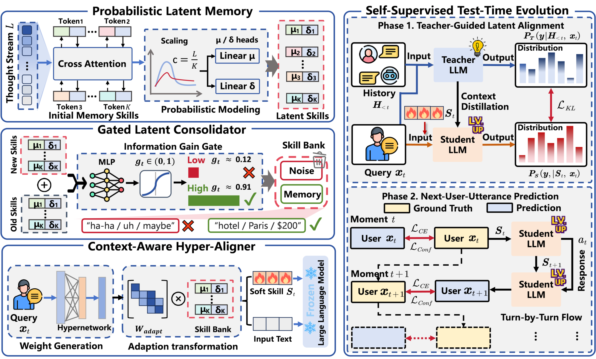

# ThinkFlow: Self-Evolving Probabilistic Latent Memory for Lifelong Conversational Agents

> Pengcheng Laboratory / Harbin Institute of Technology (Shenzhen) / China Unicom Greater Bay Area Innovation Institute · 2026-09-15 · paper · **闭环** · [论文](https://arxiv.org/abs/2609.17010)
> 机制族：记忆进化评测研究 · 来源核验 2026-09-20 · 复现状态 not-run

## Pipeline

以端到端潜在记忆取代显式文本记忆：对话流被压缩为解耦的概率潜在记忆技能（连续向量），绕开文本摘要瓶颈。测试时演化分两阶段：教师引导的潜在对齐引导初始状态（冷启动），之后自监督的下一用户话语预测任务在交互中持续精炼记忆，全程无需标注。

*图源：Figure 2 (method.png)*
## 结果（作者报告，非本地复现）

在 PersonaMem（上下文至 1M token，Qwen3-8B 主干）上，ThinkFlow-8B 平均准确率 41.94，较最强可比记忆方法（MemGen 38.86）+2.36，最强任务 +15.32；论文称在该基准可与闭源及 405B 开源模型匹敌。在 CC/MSC/GC 生成任务上优于显式记忆基线（长上下文、RAG 式与 agentic memory），并对显式管线有 token 与时延节省（图 5）。

## 证据边界

仅 v1；核验时未找到代码；生成结果为代理指标（BLEU/ROUGE/BertScore/Mauve）；PersonaMem 部分基线数字转录自 Jiang et al. (2025a) 而非重跑；与姊妹篇共享作者组与评测风格。

## 对 nanoRSI 的输入

可移植其免标注演化信号：用记忆技能对下一观测（自监督下一话语预测）的意外度降低来打分，使技能保留闸门不依赖任务标注。

## 来源

[arXiv abstract](https://arxiv.org/abs/2609.17010) · [arXiv HTML v1](https://arxiv.org/html/2609.17010v1)
