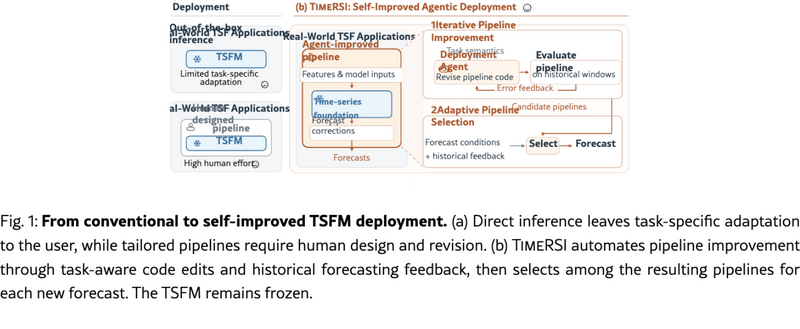

# TimeRSI: Towards Self-Improved Agentic Deployment for Time-Series Foundation Models

> Georgia Institute of Technology / University of Southern California / Samay AI · 2026-10-14 · paper · **闭环** · [论文](https://arxiv.org/abs/2610.19725) · [仓库](https://github.com/haoxin1998/TimeRSI)
> 机制族：Harness 搜索与进化 · 来源核验 2026-10-17 · 复现状态 not-run

## Pipeline

围绕冻结时序基础模型的自改进部署系统：编码智能体把任务描述翻译成可执行的流水线改动，在历史预测窗口上测试每次修订并用观测误差引导后续修订；部署期由自适应选择器按相似条件下已完成预测的表现，在积累的流水线中挑选。两个阶段 TSFM 权重均保持冻结。

*图源：Figure 1 (inline SVG with 64 foreignObject blocks; in-browser screenshot of figure#S0.F1 at page-absolute coordinates), arXiv HTML 2610.19725v2*
## 结果（作者报告，非本地复现）

在 TIME 与 FEV-bench 的 198 个任务上，TimeRSI 在六项点预测与概率预测指标上全面超过所有参赛提交（对比提交中排名第一）。受控对比支持“反馈引导修订优于非迭代流水线搜索”；进一步实验验证了跨编码智能体与跨预测模型的泛化。

## 证据边界

领域特定（预测部署）；排行榜式对比而非对每个基线的同算力重跑；代码仓库已链接但本核验未审计其产物完整性。

## 对 nanoRSI 的输入

采纳流水线编辑前先在历史窗口预验证，就是换了部署外衣的训练/验证闸门——与 nanoRSI 晋升前教义一致；在积累的流水线组合上按匹配条件下的历史表现做自适应选择，是无权重的轻量种群模式。

## 来源

[arXiv abs 2610.19725](https://arxiv.org/abs/2610.19725) · [TimeRSI code (Apache-2.0)](https://github.com/haoxin1998/TimeRSI)
