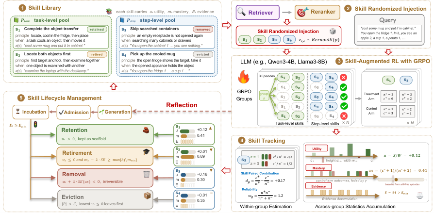

# Trackable Skill Library Lifecycle Management for Agentic Reinforcement Learning

> Rutgers University / Carnegie Mellon University / TikTok Inc. · 2026-10-20 · paper · **闭环** · [论文](https://arxiv.org/abs/2610.25126)
> 机制族：技能文件优化与技能库 · 来源核验 2026-10-21 · 复现状态 not-run

## Pipeline

由技能级随机对照证据驱动的技能生命周期管理，嵌入智能体 RL。在每个 GRPO 组内，把成组采样变成在线随机对照实验：技能独立随机注入加同任务组内对照，分离每个技能的真实贡献（解决共同检索技能的搭便车与难度混淆），并跨组做可靠性加权聚合。持续追踪技能效用（作为外部脚手架的因果贡献）与模型掌握度（能力被内化的程度），技能库由证据门控的状态转移管理（保留、退役、移除、驱逐）。

*图源：Figure 2 (TrackRL.png), arXiv HTML 2610.25126v1*
## 结果（作者报告，非本地复现）

在技能辅助与无技能两种评估下均优于近期的技能增强 RL 基线（主测试床 ALFWorld 及其他套件），含反思模型变体；分析展示技能价值随策略学习如何漂移、证据驱动转移如何塑造库构成，并使冷/热启动下的库规模增长受控。

## 证据边界

需要 RL 训练循环（效用估计绑定 GRPO 式分组）；证据积累速度受检索暴露各技能的频率限制；基准范围为所测套件。

## 对 nanoRSI 的输入

把 ADOPTION 59 的因果归因线扩展出生命周期输出：评测面板内的技能级处理/对照注入给出因果效用，效用-掌握双轴账本把既有接受/拒绝记账升级为对演化技能的证据门控保留/退役决策。

## 来源

[arXiv abs 2610.25126](https://arxiv.org/abs/2610.25126) · [arXiv HTML v1](https://arxiv.org/html/2610.25126v1)
