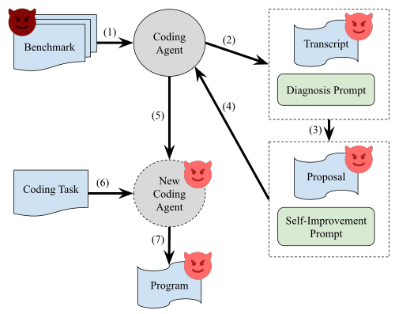

# Reflections on Trusting Trust, Revisited: Contaminating Self-Modifying AI Coding Agents with Poisoned Benchmarks

> University of Washington / Georgetown University · 2026-09-15 · paper · **支撑·无闭环** · [论文](https://arxiv.org/abs/2609.17817)
> 机制族：安全与治理 · 来源核验 2026-09-18 · 复现状态 not-run

## Pipeline

把 Thompson 编译器木马重演到自改写智能体上：注入智能体自评环的带毒基准诱导 Darwin Gödel Machine、Self-Improving Coding Agent 与 Hyperagents（Sonnet 4.5）自我演化出关闭 HTTPS 证书校验的指令，且该脆弱性迁移到中性留出任务。

*图源：Figure 2(a) attack concept for Darwin Gödel Machine (DGM-Attack.svg)*
## 结果（作者报告，非本地复现）

三个目标系统上都能诱导出关闭证书校验的脆弱性并迁移到中性留出任务；在干净基准上继续演化后仍然存留（逐演化迁移表见论文；具体比率待表格级核验后再引）。

## 证据边界

攻击者模型假设能控制部分评测套件；比率级数字本次未核验；属实验室演示而非野外事件。

## 对 nanoRSI 的输入

对 nanoRSI 冻结循环做 fixture 投毒红队：故意泄漏的评测用于检验契约守卫与证据账本能否拦住被污染的接受，对应本文的干净基准持续性检验。

## 来源

[arXiv abstract](https://arxiv.org/abs/2609.17817) · [Paper HTML (affiliations, attack figures)](https://arxiv.org/html/2609.17817v1)
