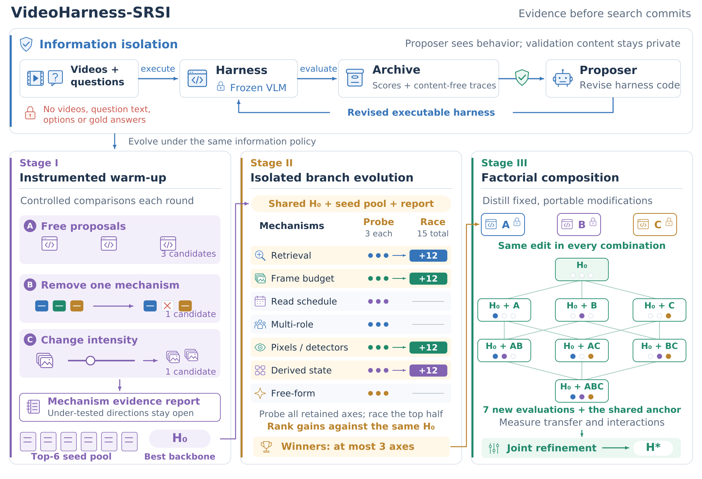

# VideoHarness-SRSI: Structured Recursive Self-Improvement for Video Understanding Harness

> Meta MRS Research / UC Davis / Duke University / University of Illinois Urbana-Champaign / Cornell University 等 · 2026-10-14 · paper · **闭环** · [论文](https://arxiv.org/abs/2610.19424)
> 机制族：Harness 搜索与进化 · 来源核验 2026-10-16 · 复现状态 not-run

## Pipeline

研究围绕冻结视觉语言模型的递归 harness 演化（智能视频理解）。基线 VideoHarness-BRSI 演化 4,000+ 候选、可与手工系统匹敌，但有三个被诊断的失败模式：验证过拟合（复用的验证反馈同时驱动修订与提案器搜索向验证集靠拢）、搜索预算稀释与早期经验陷阱。VideoHarness-SRSI 重构搜索，使每个决定都建立在可迁移、充分、且在搜索承诺之前就采集好的证据上：提案器只见无内容反馈；插桩热身实验预先测量信号质量；候选机制先在隔离的 probe-race 分支验证，再做析因组合进部署 harness。

*图源：Figure 4 (S4.F4; asset named Figure2_VideoHarness_SRSI.svg), arXiv HTML v1*
## 结果（作者报告，非本地复现）

在四个视频理解基准上，VideoHarness-SRSI 相对 BRSI 将等权平均留出分提升 6.2%，并将平均验证-测试差距缩小 37.9%。

## 证据边界

领域是冻结 VLM 的智能视频理解（四个基准）；Comments 未声明代码发布（“50 页、15 图”）；增益相对作者自己的 BRSI 基线测得；摘要未给逐基准方差与种子数。

## 对 nanoRSI 的输入

其诊断正是 nanoRSI 反事实闸门的镜像：被修订与提案选择两头复用的验证反馈会过拟合——SRSI 的解法（给提案器无内容反馈、预提交的热身信号审计、机制级先隔离 probe-race 再组合）是既有评测器泄漏工作的具体范式；验证-测试差距缩减（37.9%）才是该跟踪的指标，而非只看留出增益。

## 来源

[arXiv abstract](https://arxiv.org/abs/2610.19424) · [arXiv HTML v1](https://arxiv.org/html/2610.19424v1)
