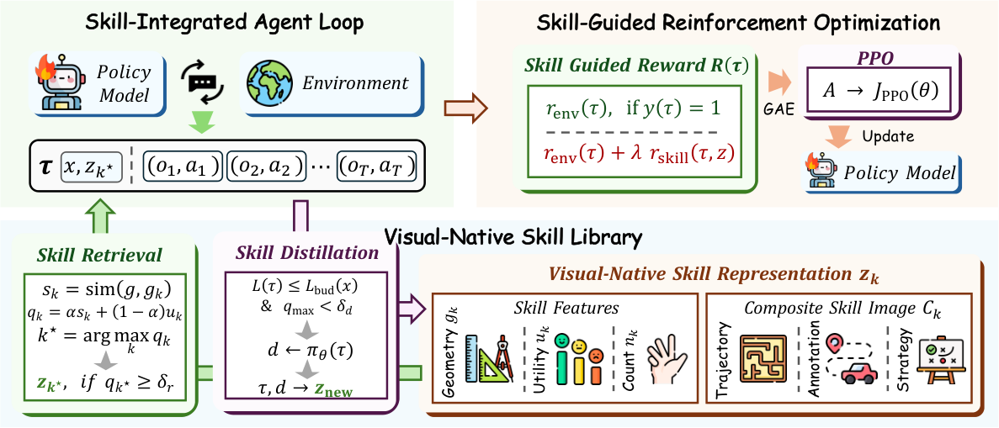

# ViSkill: Reinforcing VLM Agents with Evolving Visual-Native Skills

> Zhejiang University · 2026-10-08 · paper · **闭环** · [论文](https://arxiv.org/abs/2610.12403) · [仓库](https://github.com/ZJU-REAL/ViSkill)
> 机制族：技能文件优化与技能库 · 来源核验 2026-10-13 · 复现状态 not-run

## Pipeline

技能增强的 agent 通常把空间布局线性化为文本；ViSkill 改为把成功交互存成视觉技能卡，供 VLM agent 检索以同时引导推理与奖励塑形，同时策略用 PPO 在这些轨迹上训练；合格轨迹再蒸馏回技能库，形成技能演化与策略优化互相增强的闭环。可选冷启动机制为库播种。

*图源：Figure 2 (method.png): the agent retrieves a visual skill from the library to guide interaction, collects trajectories, and distills eligible trajectories into new skills while PPO optimizes the policy*
## 结果（作者报告，非本地复现）

在 Sokoban / FrozenLake / PrimitiveSkill 上，基础方法成功率达 0.82 / 0.84 / 1.00（总 0.89），冷启动后 0.88 / 0.85 / 1.00（总 0.91），高于 AtlasVA 0.87、VAGEN 0.80、GPT-5 0.70、o3 0.69、Claude 4.5 Sonnet 0.58、Qwen2.5-VL-72B 0.40 与 Qwen2.5-VL-3B 0.09 的总成绩，且比标准 PPO 收敛更快。消融：去掉策略优化 Sokoban 跌到 0.29；文本技能变体跌到 0.63；检索阈值 0.8、蒸馏多样性 0.9 为报告最优；演化出的技能库可迁移到未优化基座模型。

## 证据边界

评估仅限 VAGEN 框架环境；更复杂或开放场景的收益未验证。技能引导奖励假设部分进展会到达检索技能中出现的状态，当有效解穿越不相交状态路径时引导有限。

## 对 nanoRSI 的输入

模态这一点超出视觉本身：nanoRSI 技能是文本文件，而这是「以执行器原生表示（而非有损序列化）存储经验会改变技能演化可表达内容」的实测证据——值得在技能产物可以是数据文件而非散文的数字/面板任务上做一次最小 A/B。

## 来源

[arXiv abstract](https://arxiv.org/abs/2610.12403) · [arXiv HTML v1](https://arxiv.org/html/2610.12403v1) · [GitHub repository (MIT)](https://github.com/ZJU-REAL/ViSkill)
