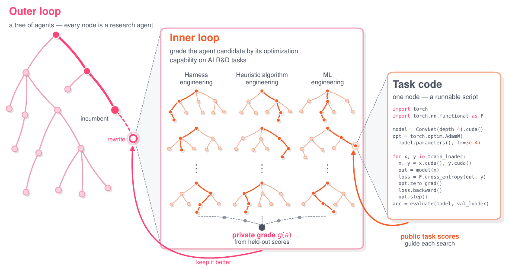

# AIDE²: The First Evidence of Recursive Self-Improvement

> Weco AI · 2026-07-14 · report · **闭环** · [论文](https://www.weco.ai/blog/first-evidence-of-recursive-self-improvement) · [仓库](https://github.com/WecoAI/aideml)
> 机制族：自改写元智能体与谱系 · 来源核验 2026-09-29 · 复现状态 not-run

## Pipeline

双层循环：外环智能体改写内环研究智能体的代码；每个候选在固定的逐任务预算下跨异构 AI 研发任务族评测，并在接受前把留出分数汇总为私有等级。论文报告一条包含 100 个节点、接受 7 次重写的轨迹；演化后的 harness 改变搜索策略、上下文管理和奖励黑客防护，而每层循环内的底层模型保持固定。

*图源：Figure 1 (figures/fig_system_diagram_light.pdf): one step of recursive self-improvement*
## 结果（作者报告，非本地复现）

一次 8 天无人值守运行接受了 7 次重写，私有选择等级从 0.703 提升到 0.778。在四个留出基准上，AIDE₈₅ 按相同协议达到或超过人工构建基线，其中包括分布外的 WeatherBench 2；在另一个留出的 KernelBench 式任务族上，奖励黑客率从 55% 降至 32%，人工基线为 39%。另外两次完整运行也显示持续改进，但点火测试没有统计上决定性的结果。这些是作者报告，不是 nanoRSI 复现。

## 证据边界

主轨迹是一次昂贵的托管模型运行；论文指出比较带噪、部分基线评测因上下文窗口失败，且不同 checkpoint 的收益并不单调。外环点火结果不确定；报告中的“递归自我改进”指固定评测预算下的 harness／搜索效率，不是模型权重自改进，也不是通用 RSI 门槛。

## 对 nanoRSI 的输入

把 AIDE² 作为既有 RRSI 选择器研究的协议参照：固定内层任务预算，把公开反馈与留出接受等级分开，并报告完整的接受／拒绝谱系。不要复制 Weco 代码，也不要把论文基准收益说成本地结果；先冻结 nanoRSI 的三种子、三预算点协议和成本上限。

## 来源

[Weco AI blog report](https://www.weco.ai/blog/first-evidence-of-recursive-self-improvement) · [AIDE² technical report](https://arxiv.org/html/2609.26457v1) · [Related AIDE predecessor repository](https://github.com/WecoAI/aideml) · [Related AIDE predecessor license](https://raw.githubusercontent.com/WecoAI/aideml/main/LICENSE)
