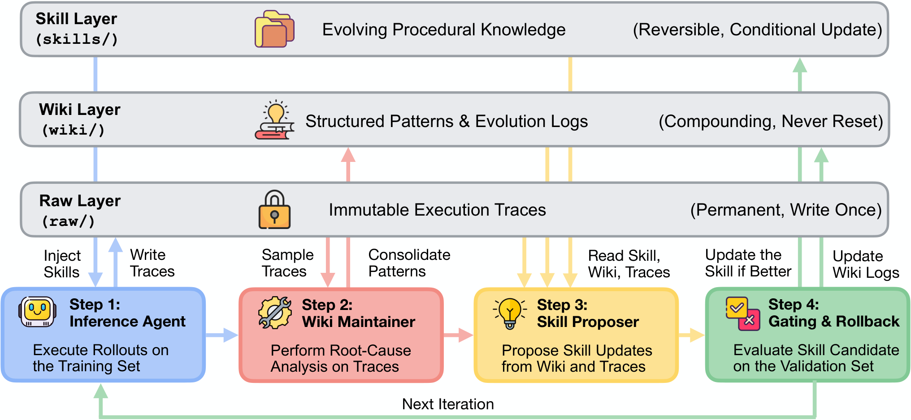

# WikiSkill: Compiling Agent Experience into Persistent Knowledge for Skill Evolution

> Google Research / Virginia Tech · 2026-08-27 · paper · **闭环** · [论文](https://arxiv.org/abs/2608.27454)
> 机制族：技能文件优化与技能库 · 来源核验 2026-09-16 · 复现状态 not-run

## Pipeline

三层工作区：不可变的原始执行轨迹、跨迭代复利的持久 wiki（模式、日志、技能影响记录）、活跃的 SKILL.md 技能层。每轮推理智能体带技能（但不可访问 wiki）执行；wiki 维护者把采样轨迹固化为模式；技能提案者读 wiki 与轨迹，提议一次原子技能编辑；验证闸门决定接受或回滚技能——而 wiki 本身永不回滚，持续累积已接受/已拒绝 diff 的真值审计轨迹。

*图源：Figure 2*
## 结果（作者报告，非本地复现）

五个基准 x 五个模型、3 次运行、配对 bootstrap p<0.05：WikiSkill 全格胜过无技能、Trace2Skill、EvoSkill 与 SkillOpt（如 Gemini-3.5-Flash 68.1 对 SkillOpt 55.9；Qwen-3.6-27B 63.3 对 50.7）。增益随模型规模扩大（Qwen 4B/9B/27B +12.3/+17.5/+23.9）；Qwen-3.5-9B + WikiSkill（47.4%）胜过无技能的 Qwen-3.6-27B（39.4%）。消融：只给提案者 wiki 访问 +15.0；给推理智能体 wiki 访问反而 -7.2。

## 证据边界

技能全量注入提示（未评估检索/触发）；严格闸门会拒绝可能支撑后续收益的中性提案；无自动 wiki 剪枝；未覆盖超长时程任务。

## 对 nanoRSI 的输入

对 nanoRSI：把'永不回滚的知识'（wiki，含接受/拒绝 diff）与'可回滚的可执行技能'分层——一个单调增长的审计层，让技能闸门决策可事后复查。

## 来源

[arXiv abstract](https://arxiv.org/abs/2608.27454) · [Paper v1 (affiliations, Figure 2, main table)](https://arxiv.org/html/2608.27454v1)
