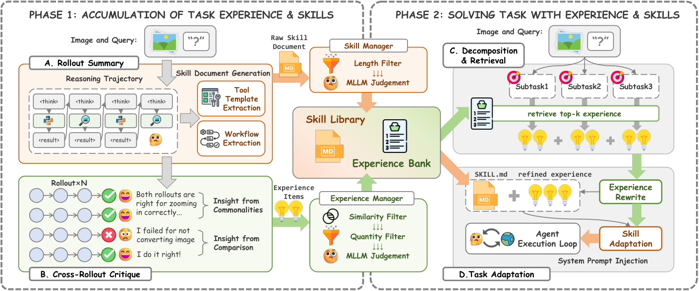

# XSkill: Continual Learning from Experience and Skills in Multimodal Agents

> Hong Kong University of Science and Technology / Zhejiang University / Huazhong University of Science and Technology · 2026-03-12 · paper · **闭环** · [论文](https://arxiv.org/abs/2603.12056) · [仓库](https://github.com/XSkill-Agent/XSkill)
> 机制族：结构化知识库与图 · 来源核验 2026-09-17 · 复现状态 not-run

## Pipeline

面向多模态智能体的免训练持续学习，双流知识：任务级 Markdown 技能（含可复用工具模板）与短条件-动作经验条目（上限 120 条，嵌入检索）。抽取做视觉落地（记录每个动作由什么视觉证据驱动），跨 rollout 批评对比成功/失败轨迹产出增改操作；测试时子任务按流各检索 top-3、适配当前图像后非指令式注入。使用历史回流支持持续精炼。

*图源：Figure 2*
## 结果（作者报告，非本地复现）

四个多模态基准 x 四个骨干：对仅工具基线 average@4 +2.58~+6.71；对最强基线最高 +11.13（TIR-Bench、Gemini-3-Flash：47.75 对 Agent-KB 36.62）；执行错误率从 29.9% 降到 15.3%。消融：去经验 -3.04、去技能 -3.85、去经验管理器 -4.09。从 Gemini-3-Flash 迁移的知识也提升 GPT-5-mini（20.61 -> 23.19）。

## 证据边界

仅演示单轮'先积累后测试'（迭代精炼有架构支持但未测）；迁移知识损害 Qwen 系 average@4（Qwen3-VL-235B 11.80 -> 11.52），基座能力是关键；作者提示环内偏置传播并建议人工监督。

## 对 nanoRSI 的输入

对 nanoRSI：把任务级技能与短条件-动作经验分开（各自上限与检索），并记录驱动每个动作的视觉/文本证据，让批评能对照'有依据的原因'而非原始日志。

## 来源

[arXiv abstract](https://arxiv.org/abs/2603.12056) · [Paper v3 (affiliations, Figure 2, tables)](https://arxiv.org/html/2603.12056v3) · [Code repository](https://github.com/XSkill-Agent/XSkill)
