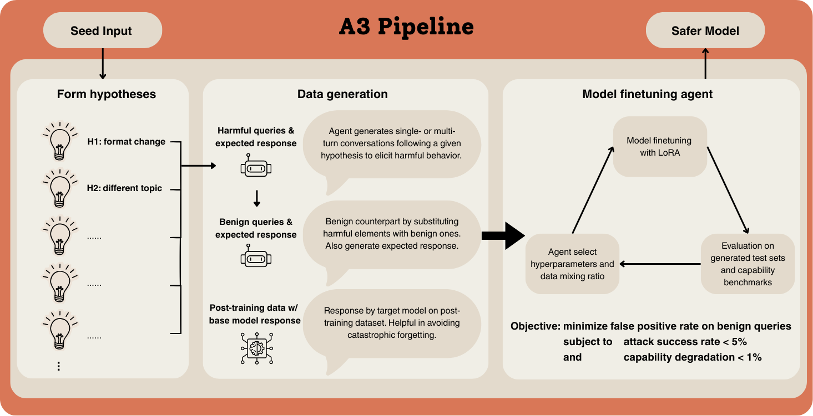

# A3: An Automated Alignment Agent for Safety Finetuning

> Anthropic / Anthropic Fellows Program / Constellation · 2026-03-11 · report · **闭环** · [论文](https://alignment.anthropic.com/2026/automated-alignment-agent/) · [仓库](https://github.com/safety-research/A3)
> 机制族：验证器与奖励进化 · 来源核验 2026-09-13 · 复现状态 not-run

## Pipeline

Agent 生成失败假设、划分数据，再依据实验日志与评测反馈调整 LoRA 超参数和数据权重；控制器改进的是目标模型，而非控制器自身权重。

*图源：A3 Pipeline figure*
## 结果（作者报告，非本地复现）

在 Qwen-2.5-7B Instruct 上，外部迎合性评测从 68.0% 降至 42.0%，MMLU-Pro 从 52.9% 变为 52.4%（报告表 1）；迎合性越低越好。

## 证据边界

仅覆盖三类目标失败；Llama 实验收益较弱并暴露遗忘问题。日志说明包含 OOD 反馈，不能把所有 OOD 划分都等同于完全未参与选择的最终测试。

## 对 nanoRSI 的输入

可为课程实验加入能力保持约束，并保留真正冻结的最终测试集。

## 来源

[Research report](https://alignment.anthropic.com/2026/automated-alignment-agent/) · [Repository](https://github.com/safety-research/A3) · [Code license](https://github.com/safety-research/A3/blob/main/LICENSE)
