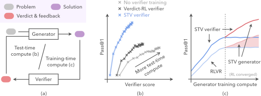

# Self-Trained Verification for Training- and Test-Time Self-Improvement

> Carnegie Mellon University · 2026-05-28 · paper · **闭环** · [论文](https://arxiv.org/abs/2605.30290) · [仓库](https://github.com/AR-FORUM/stv)
> 机制族：验证器与奖励进化 · 来源核验 2026-09-16 · 复现状态 not-run

## Pipeline

利用'模型无法冷诊断自身错误、但看到参考解就可以'的不对称性。参考条件化验证器（教师）通过 (verdict, feedback) 分布的在线策略蒸馏 + 对照真值的 verdict-RL 项监督无条件化学生；直接 SFT 教师轨迹会因离策略漂移而失败。训练出的验证器同时驱动测试时验证-精炼环与验证器在环（ViL）的生成器 RL 训练——验证器本身即自改进产物。

*图源：Figure 1*
## 结果（作者报告，非本地复现）

困难数学上准确率约翻倍（末轮 Hardest 5.5% 对 Qwen3-32B 流水线 2.7%）；SciKnowEval Hardest 1.5% -> 21.0%、Hard 11.5% -> 42.4%，超过 Qwen3-235B-A22B；对已收敛 RLVR 生成器，ViL 再加 +33% 相对 pass@1，而继续 RLVR 无增益；STV 训练的 4B 验证器接近 8B（26.4% 对 27.4%）。

## 证据边界

作者自述开放问题：能否推广到'从头不可验证'的任务之外、其他监督信号、更大模型，以及生成器/验证器/测试时轮次的最优算力分配。

## 对 nanoRSI 的输入

对 nanoRSI：让验收验证器模仿自身'参考条件化'的判断来训练，再用这个自训练验证器闸门每个候选变更——用廉价的学习型检查器直接强化冻结评估器不变量。

## 来源

[arXiv abstract](https://arxiv.org/abs/2605.30290) · [Paper v2 (affiliations, Figure 1, all tables)](https://arxiv.org/html/2605.30290v2) · [Code repository (Apache-2.0)](https://github.com/AR-FORUM/stv)
