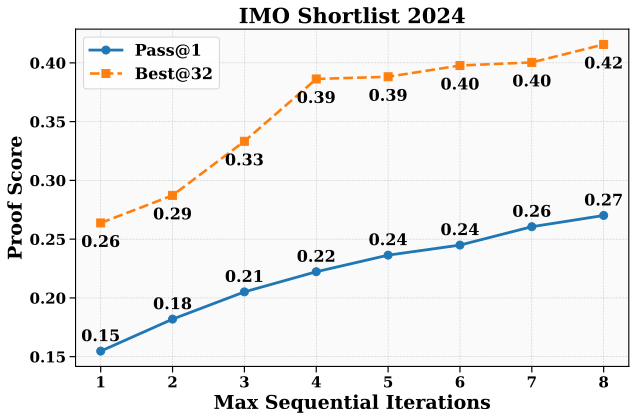

# DeepSeekMath-V2: Towards Self-Verifiable Mathematical Reasoning

> DeepSeek-AI · 2025-11-27 · paper · **闭环** · [论文](https://arxiv.org/abs/2511.22570) · [仓库](https://github.com/deepseek-ai/DeepSeek-Math-V2)
> 机制族：验证器与奖励进化 · 来源核验 2026-09-13 · 复现状态 not-run

## Pipeline

验证器为生成器训练提供奖励；提高验证计算量，自动标注新生成的难验证证明，再训练验证器。专家标注启动的元验证器检查批评是否可信。推理时保留高分证明并据批评继续修改；这一层改变解答而非权重。

*图源：Figure 2*
## 结果（作者报告，非本地复现）

作者报告经专家评估后 Putnam 2024 得分 118/120。高计算量搜索从 64 份证明及每份 64 次分析开始，选取前 64 份证明，每份抽取 8 次分析，最多迭代 16 轮；并非单次生成成绩。

## 证据边界

自然语言验证仍可能出错，并依赖专家初始监督；证明搜索成功本身不等于模型递归改进。

## 对 nanoRSI 的输入

拟议 nanoRSI learner 适配器：分别版本化生成器、验证器、标签及专家审计，对比共同训练与冻结验证器。

## 来源

[arXiv first submission](https://arxiv.org/abs/2511.22570) · [Paper v1 methods and high-compute evaluation](https://arxiv.org/html/2511.22570v1) · [Official DeepSeek-Math-V2 repository](https://github.com/deepseek-ai/DeepSeek-Math-V2) · [Official weights and Apache-2.0 statement](https://huggingface.co/deepseek-ai/DeepSeek-Math-V2)
