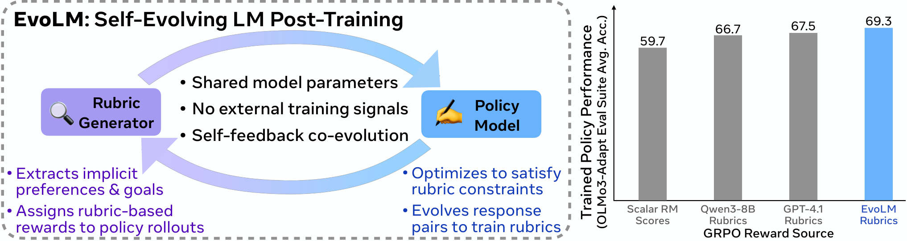

# EvoLM: Self-Evolving Language Models through Co-Evolved Discriminative Rubrics

> University of Washington / Allen Institute for AI / University of Pennsylvania · 2026-05-05 · paper · **闭环** · [论文](https://arxiv.org/abs/2605.03871) · [仓库](https://github.com/stellalisy/EvoLM)
> 机制族：验证器与奖励进化 · 来源核验 2026-09-18 · 复现状态 not-run

## Pipeline

规则生成器输出逐实例的自然语言评判标准，小至 0.6B 的冻结评判者据此给策略打分；生成器以二元判别奖励（评判者能否正确排序由策略自身前后检查点经时间对比构成的偏好对）经 GRPO 训练，生成器与策略交替共进化并配回放缓冲——无人类标注、外部奖励模型或更强教师。

*图源：Figure 1 (rubric_fig1.png)*
## 结果（作者报告，非本地复现）

Qwen3-8B 生成器在 RewardBench-2 上超过 GPT-4.1 规则 25.7%；共训练策略在 12 基准 OLMo3-Adapt 套件均分 69.3%（比 GPT-4.1 提示规则高 3.9）；在分布外深度研究任务上其规则与专家人类规则的一致率高于 GPT-4.1（HealthBench 58.4% 对 52.5%、ResearchQA 59.3% 对 51.0%）；框架可迁移到 OLMo-3-7B，规则无需重训即可迁移到未见策略与评判者。

## 证据边界

作者自报；时间对比的偏好构造把监督质量与检查点节奏绑定；评判质量指标（RewardBench-2/JudgeBench）本身基于 LLM 评判。

## 对 nanoRSI 的输入

时间对比可直接移植：用 nanoRSI 冻结版对候选版的输出构造偏好对，训练小规则评分器作为替代逐候选全滚动的廉价闸门（扩展 ADOPTION 第 19 项）。

## 来源

[arXiv abstract](https://arxiv.org/abs/2605.03871) · [Paper HTML (affiliations, results, Figure 1)](https://arxiv.org/html/2605.03871v1) · [EvoLM repository](https://github.com/stellalisy/EvoLM)
