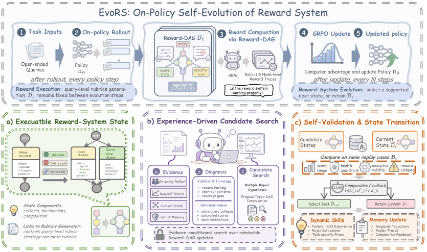

# EvoRS: On-Policy Self-Evolution of Reward Systems for Open-Ended Reinforcement Learning

> Fudan University / Nankai University / Hello Group · 2026-09-11 · paper · **闭环** · [论文](https://arxiv.org/abs/2609.12459)
> 机制族：验证器与奖励进化 · 来源核验 2026-09-16 · 复现状态 not-run

## Pipeline

奖励系统本身即进化对象：一个可执行的 Reward-DAG，其评分规则节点（判据 + 打分机制）与组合算子共同定义 RL 奖励。每 N 次策略更新，一个智能体设计器读在线策略 rollout 与节点级奖励轨迹，诊断有效性/覆盖/信息量失败并提议有界类型化编辑；'匹配回放'在同一批 rollout 上对比当前与候选奖励状态，只有既修复目标失败又保留有用奖励行为的候选才成为下一活动状态。结果进入运行内记忆与动态技能。

*图源：Figure 4*
## 结果（作者报告，非本地复现）

WritingBench 57.001 对基线 54.894（+2.107，三评审均值：GPT-5.6-Terra/DeepSeek-V4-Pro/GLM-5.2），且是唯一黑客率低于基线的方法（6.5 对 7.7）；CoSER 65.676 对 60.909（+4.767），四维全部第一。跨奖励模型泛化（Qwen3-8B：66.370 对 RaR 62.044）。消融：固定最终 Reward-DAG 损失 -0.693/-5.103；去候选选择 -3.182；去进化记忆 -3.264。约 192 A800 GPU 时/次。

## 证据边界

仅在写作与角色扮演上评测；智能体/工具场景未验证；固定每 N 步的进化节奏；周期性诊断与候选评估有额外算力开销。

## 对 nanoRSI 的输入

对 nanoRSI：评估器一侧同样可以进化——把奖励定义版本化为 DAG，设计器提议类型化编辑，且只在相同 rollout 上做匹配回放对比后接受；像拒绝技能一样记录被拒的奖励编辑。

## 来源

[arXiv abstract](https://arxiv.org/abs/2609.12459) · [Paper v1 (affiliations, Figure 4, Tables 1-3)](https://arxiv.org/html/2609.12459v1)
