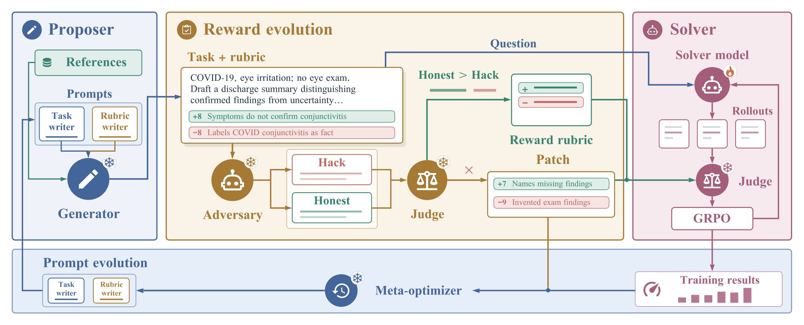

# Recursive Reward Improvement via Adversarial Meta-Prompt Evolution

> Massachusetts Institute of Technology / Microsoft Research / Johns Hopkins University · 2026-10-15 · paper · **闭环** · [论文](https://arxiv.org/abs/2610.21040) · [仓库](https://github.com/DDVD233/RRI)
> 机制族：验证器与奖励进化 · 来源核验 2026-10-19 · 复现状态 not-run

## Pipeline

面向无标准答案专业任务（临床报告生成）的提案者-求解者 RSI 环：提案者从医学参考资料生成任务与带权重的评分量表（rubric）；冻结的对抗者对每个任务作答两次——一次钻空子、一次诚实作答——修复步骤重写量表，只保留能将诚实答案排在钻空子答案之上的条目；修补后的量表在“攻击-修补-准入”环中被再攻击；求解者以 GRPO 在量表奖励上训练；元优化器依据训练反馈与已确认的攻击改写提案者的生成提示词。

*图源：Figure 1 (RRIMed_main_figure.png), arXiv HTML 2610.21040v1*
## 结果（作者报告，非本地复现）

HealthBench Professional（带检索的调整分）：RRI 相对 Generation Only 在 9B 上 +10.9 分、27B 上 +12.4 分（27B 未训练 0.374 在 Generation Only 下仅 +1.8，RRI 下 +14.2）；由冻结 9B 担纲全部辅助角色的 all-self 设置 +10.3。完整 RRI 0.533，对 SibylSense 0.502、EvoRubrics 0.493、合成任务 RaR 0.433；在基准官方 GPT-5.4 评判下排序与差距保持。写作类 9B +39.1 分（0.199→0.590）；难任务 +18.6 对普通任务 +2.8。27B 域外：PRBench Hard +6.6（0.189→0.255）、ProfBench +8.0（0.345→0.425），对以 Generation Only 数据训练的 Self-Improve 臂 +1.2/+4.7——域外增益主要来自修复奖励；HealthBench Hard 0.246 对 0.188/0.143。

## 证据边界

对抗者仍能攻破多数修补后的量表——首轮修补后 293 例中 247 例又找到新漏洞（每个成为下一轮目标）；准入改写把新漏洞对诚实答案的平均领先从 0.43 压到 0.01，但仅约三分之一任务上诚实答案反超；无检索时 all-self 增益降至 +4.0；自评设置下科研类任务下滑。

## 对 nanoRSI 的输入

“攻击-修补-准入”是 nanoRSI 的评测器审计原语：在信任按判分标准测得的增益前，先要求对抗者产出钻空子产物，核验判分标准将诚实产物排在漏洞产物之上；已确认的漏洞进入有界的标准修补而非整体重写评测器。这是反事实面板在判分标准侧的补位。

## 来源

[arXiv abs 2610.21040](https://arxiv.org/abs/2610.21040) · [arXiv HTML v1](https://arxiv.org/html/2610.21040v1) · [RRI code](https://github.com/DDVD233/RRI) · [RRI LICENSE (Apache-2.0)](https://raw.githubusercontent.com/DDVD233/RRI/main/LICENSE)
