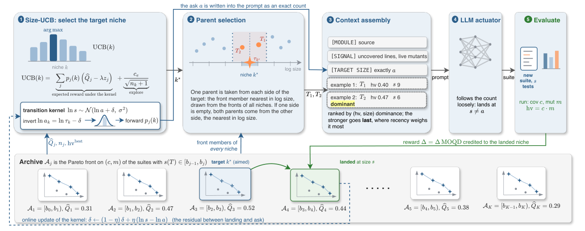

# Small but Mighty: Test Suites as Improvement Signals for Self-Evolving Agents

> Virginia Tech / NEC Laboratories America · 2026-10-11 · paper · **闭环** · [论文](https://arxiv.org/abs/2610.15964) · [仓库](https://github.com/ccsnow127/TeSearch)
> 机制族：技能文件优化与技能库 · 来源核验 2026-10-15 · 复现状态 not-run

## Pipeline

演化小型可执行测试套件，作为自编辑 harness 代码的接受/拒绝信号。质量-多样性搜索按套件规模生态位维护（覆盖率、变异得分）的帕累托前沿，让小而强的套件存活；交付套件是超体积最大者中最小的。学习到的落点核补偿 LLM 对套件规模指令的噪声服从（对数正态模型、在线估计计数偏差），并按请求实际落点加权老虎机信用；规模退火 UCB 在质量过阈后才惩罚规模。闸门：套件先对未修改模块跑通；修订模块若让先前通过的套件失败即被拒——无需模型调用即可拦截改变行为的自编辑。

*图源：Figure 1 (fig1_overview.png): the TeSearch archive keeping a Pareto front on (coverage, mutation score) per size niche, feeding suite-gated harness rewrites*
## 结果（作者报告，非本地复现）

129 个 TestGenEval Python 模块、3 骨干（GPT-5.4、Claude Opus 4.8、Gemini 3.1 Pro）：行为改变型重写的拒绝率 59.9% 对仓库测试的 25.3%，逐模块全面更优；等价重写上的误报率 4.0%（10/253）；判定 3.5 秒对 5.9 秒且零模型调用；每个骨干上超体积最高（超最佳基线 7.0-8.5）且套件最小（如 hv 0.976、规模 29.1）。自演化研究：8 个 mini-swe-agent harness 模块、470 条已验证修订、评分者间 kappa 0.74。

## 证据边界

4.0% 误报率意味着等价重写偶被误拦（仓库测试为 0%）；评测仅限 Python（TestGenEval 模块）；自演化研究覆盖 8 个 harness 模块；HTML 邮箱-作者映射错乱（已如实记录）。

## 对 nanoRSI 的输入

对 nanoRSI 的核心迁移：用专门演化出的小套件而非任务自带测试来闸自编辑——套件先在父代跑通再判子代，提供带实测误拦率的行为保持检查（TeSearch 的 4.0% 即参考值）。规模生态位帕累托档案也是让评测工件小到可在 episode 预算内逐次运行的具体范式。

## 来源

[arXiv abstract](https://arxiv.org/abs/2610.15964) · [arXiv HTML v1](https://arxiv.org/html/2610.15964v1) · [ccsnow127/TeSearch (MIT)](https://github.com/ccsnow127/TeSearch)
