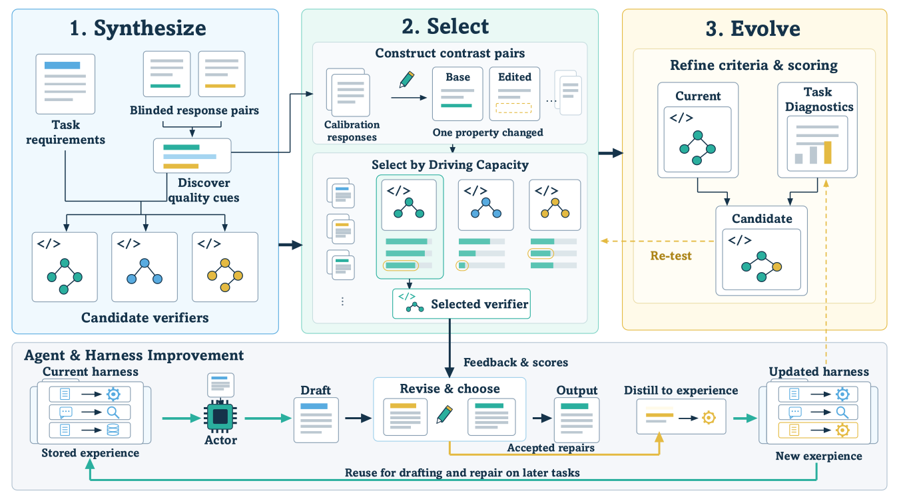

# Verifier-Harness Co-Evolution for Training-Free Self-Improvement on Open-Ended Tasks

> Oregon State University / Pennsylvania State University / AG2 AI / Johnson & Johnson · 2026-10-13 · paper · **闭环** · [论文](https://arxiv.org/abs/2610.17609)
> 机制族：反馈审查与编排 · 来源核验 2026-10-15 · 复现状态 not-run

## Pipeline

免训练地把可执行验证器程序 V=（打分器组、聚合器、诊断器）与 agent 的 harness 状态共同演化。验证器候选由挖掘到的'Actor 对更大冻结模型'响应对比（恰好差一个目标缺陷族的响应对）合成，按驱动力选择——候选在最弱对比族上的判别力（对比族上的 maximin；定理 1 证明其对任意族混合最大化最坏情形成功率）。验证器给草稿打分、把最弱准则诊断为一次局部修复，仅当修订的奖励以边际超过草稿才上线；只有被接受的修复可向 harness 写入任务派生内容，且蒸馏为至多一条有界触发-动作程序。检查点上验证器自身由累积诊断重新合成，仅当最弱族严格增益且赢得的留出对比多于输掉的（W>L）、每族都在容差 kappa=0.10 内才替换。

*图源：Figure 2 (fig2v3.svg): UCoE workflow - verifier side (synthesize / contrast-select / evolve) coupled to agent side (draft / revise / distill), with accepted repairs gating harness updates*
## 结果（作者报告，非本地复现）

开放式偏好（平局调整、Qwen3.5-397B 评审）对匹配的直接生成：Qwen3-8B 平均 59.00%、Qwen3.8-27B 57.19%（最佳基线 49.26/51.60），12 个基准×Actor 设置全胜（Arena-Hard、WritingPrompts、WildBench、WritingBench、MultiChallenge、RefineBench）。可验证任务（8B）：均值 36.06%→38.48%，IFBench 30.00→34.67、Hard-MATH 56.54→59.16、BigCodeBench-Hard 无损而所有基线跌破直接生成。Codex agent harness 内 SpreadsheetBench-2（GPT-5.6-luna）：精确匹配 22.7% 对 17.3%。消融：完整 58.30% 对只更新 harness 50.80%、固定验证器 56.60%。机制核查：更新后验证器的 94 个被接受提案中，外部评审 73 个更好（7 差、14 平）。

## 证据边界

偏好由大号 Qwen 模型评审（与 Actor 骨干同家族）；论文不同段落混用 'Qwen3-8B' 与 'Qwen3.8-27B' 命名；头版代码链接核验时 404；开放式任务无真值，一切改进都是相对偏好的。

## 对 nanoRSI 的输入

对比族 maximin 选择与'W>L 且带容差'替换规则是 nanoRSI 评测器轨道现成的闸门准则：候选验证器只有在任何对比族不更差且总体严格更好时才替换在位者——是 ADOPTION 第 44 项锚定参考一致性检查的可计算类比。'只有被接受的修复才写记忆、每次接受至多一条有界程序'也约束了记忆的无界增长。

## 来源

[arXiv abstract](https://arxiv.org/abs/2610.17609) · [arXiv HTML v1](https://arxiv.org/html/2610.17609v1)
