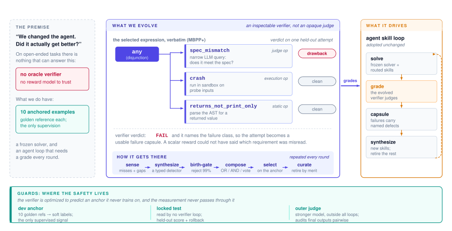

# Who Verifies the Verifier? Co-Evolving Inspectable Graders with Self-Improving Agents

> Amazon Web Services / HSBC · 2026-10-08 · paper · **闭环** · [论文](https://arxiv.org/abs/2610.11464)
> 机制族：反馈审查与编排 · 来源核验 2026-10-13 · 复现状态 not-run

## Pipeline

把校验器本身作为演化对象：一个由小型、多为确定性的缺陷检测器合成的可检查表达式，检测器从聚类失败中合成、出生即受闸门约束，表达式按与锚定的十例参照集的一致性加未标注输出上的共识来选择——绝不按 agent 分数选择。协同演化系统（Double Ratchet）把该校验器与带生命周期的技能循环配对；当演化技能钻报告评分空子时，外层 judge 在拿到任务契约后才抓到，新增一个检测器即修复。

*图源：Figure 1 (hero_wv.svg): the selected MBPP+ verifier as an expression over typed detectors, with the anchored premise, the consuming skill loop and the anchor guards*
## 结果（作者报告，非本地复现）

在 MBPP+ 上，演化校验器每个种子都达到 0.625+-0.050 保留一致率，高于手写种子 0.417+-0.058（+0.21）与其内含的裸 LLM judge 0.55+-0.04。Double Ratchet 在代码生成、企业 text-to-SQL 与无参照报告生成上保有真值或手写评分所提供增益的 88-110%（MBPP+ 106%、Spider 110%、报告 88%）。去掉锚定守卫后校验器塌缩为全通过评分器，却仍把技能训练得一样好——下游任务分数不能给自演化校验器作证。报告评分上的钻空子从约 30% 无价值标签降到修复后约 1%；任务感知外层 judge 胜率 0.515->0.770。

## 证据边界

这是机制研究而非规模结果：三个任务族、一个模型族、数百轮、几十例保留集、单一外层 judge 且无人工小组；技能循环在 2900 轮中的 23 轮触碰了锁定的回滚/评估集（技能绝对水平偏乐观）；干净执行但语义错误的输出（Spider）仍难检测；外层 judge 在拿到任务契约之前自己也判错。

## 对 nanoRSI 的输入

直接塑造 nanoRSI 闸门量测：除下游分数外一并报告校验器效度（与锚定参照集的保留一致率），保留全通过评分器臂作为诚实零假设，并为每次过闸变更记录检测器级来源——把条目 40 的量测闸门字段扩展出技能分数无法作证的效度轴。

## 来源

[arXiv abstract](https://arxiv.org/abs/2610.11464) · [arXiv HTML v1](https://arxiv.org/html/2610.11464v1)
