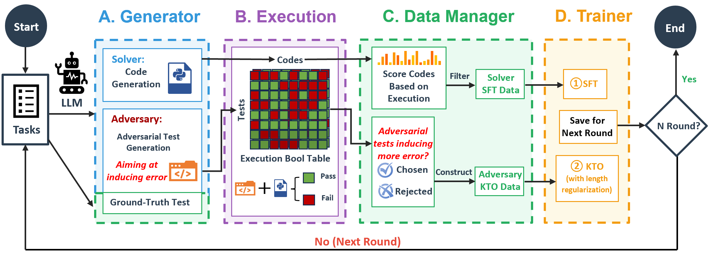

# ACE: Self-Evolving LLM Coding Framework via Adversarial Unit Test Generation and Preference Optimization

> Fudan University · 2026-04-17 · paper · **闭环** · [论文](https://arxiv.org/abs/2605.16299)
> 机制族：自博弈与课程任务生成 · 来源核验 2026-09-19 · 复现状态 not-run

## Pipeline

单个 LLM 交替扮演 Solver（写代码）与 Adversary（构造对抗单元测试）；执行 pass/fail 布尔表驱动 Solver 侧 SFT 过滤与 Adversary 侧 KTO 偏好优化，多轮递归自改进，无需 ground-truth 代码或外部奖励模型。

*图源：Figure 2 (method_pipeline.png)*
## 结果（作者报告，非本地复现）

共享底座的双 LoRA 适配器：Qwen3-4B 经 5 轮自进化 CodeContests pass@1 46.7（instruct 41.7、ReasonFlux-Coder-4B 24.0）、LiveCodeBench 37.5；Qwen2.5-7B 在 OOD LiveCodeBench 38.9，对照 ReasonFlux-Coder-7B 33.5、instruct 30.4。

## 证据边界

作者自报；对抗测试的强度受限于对抗者策略（测试质量无外部核验）；未找到代码发布。

## 对 nanoRSI 的输入

nanoRSI 可让提案者在候选编辑之外同时产出对抗探针用例：两者的执行结果共同构成验收信号，在最小任务集上去掉对裁判模型的依赖。

## 来源

[arXiv abstract](https://arxiv.org/abs/2605.16299) · [Paper HTML (affiliations, Table 2, Figure 2)](https://arxiv.org/html/2605.16299v2)
