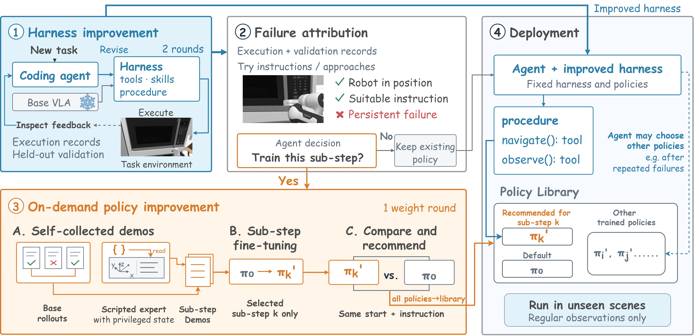

# AdaRSI: On-Demand Recursive Self-Improvement for Embodied Agents

> Northeastern University (China) / AgiBot / University of Chinese Academy of Sciences · 2026-10-14 · paper · **闭环** · [论文](https://arxiv.org/abs/2610.20474)
> 机制族：技能-权重共进化 · 来源核验 2026-10-17 · 复现状态 not-run

## Pipeline

回答“自改进具身系统何时该改执行器权重”：编码智能体先改进技能与 harness；再从保存的状态重试失败子步骤做失败归因（失败在调用方式还是能力本身）；只对仍不可靠的子步骤做微调，演示由系统自采、经验从早前任务迁移。

*图源：Figure 2 (figures/AdaRSI_pipeline.jpg), arXiv HTML 2610.20474v1*
## 结果（作者报告，非本地复现）

在 RoboCasa365 全部 50 个目标任务（各 50 场景）上，以 GR00T N1.5 为执行器、无人类演示：AdaRSI 在三个套件上均提升 VLA，未见组合任务成功率从 4.6% 升至 13.8%。与“每个子步骤都微调”相比，成功率略高而只用 28% GPU 时间与 22% 自采演示；不带 harness 的微调训练更多、收益远低。

## 证据边界

HTML 未找到代码链接；单一执行器（GR00T N1.5）与单一基准族（RoboCasa365）；子步骤归因假设保存状态重置能忠实隔离失败。

## 对 nanoRSI 的输入

“先改 harness、只对持续不可靠子步骤改权重”的边界正是 nanoRSI 冻结执行器教义所在：将来任何权重侧实验臂都应照抄这种“先归因再微调”的闸门（从保存状态重试），而不是失败即微调。

## 来源

[arXiv abs 2610.20474](https://arxiv.org/abs/2610.20474) · [HTML full text v1](https://arxiv.org/html/2610.20474v1)
