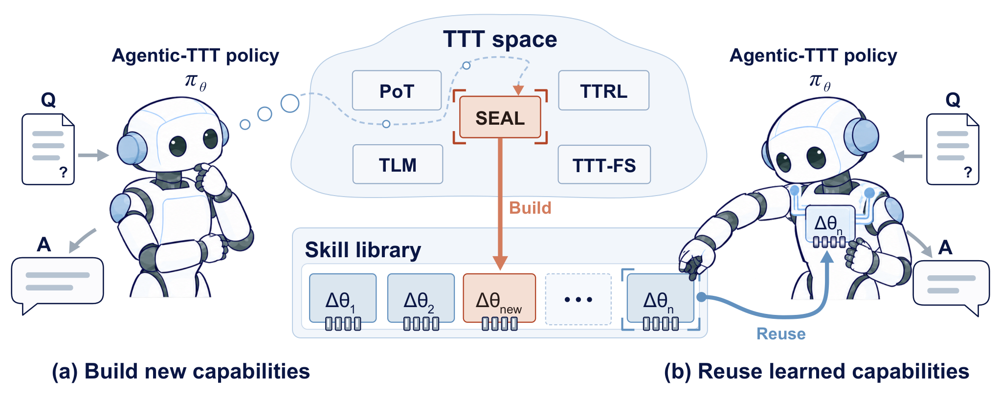

# Agentic-TTT: Training test-time policy for test-time training

> NUS AI Institute / National University of Singapore · 2026-10-08 · paper · **闭环** · [论文](https://arxiv.org/abs/2610.12002)
> 机制族：自主训练智能体与数据管线 · 来源核验 2026-10-12 · 复现状态 not-run

## Pipeline

把测试时训练（TTT）过程封装为可调用工具，由学习到的测试时策略决定是否适配、调用哪个 TTT 算法、以及能否复用已有的参数级技能而非新训练。累积的技能构成不断变化的部署环境，策略由自身决策产生的效用增益训练；计算惩罚（lambda_comp）引导它做选择性适配而非均匀抑制。

*图源：Figure 1 (agentic-ttt-teaser.png): the learned policy governing when and how to (a) build or (b) reuse parameter-level adaptations at test time*
## 结果（作者报告，非本地复现）

在作者基准上，学习策略的效用较骨干模型接近翻倍，在惩罚下学会效用与计算的权衡，并外推到策略训练未见的领域：在 G1（代码、通用推理、逻辑游戏）、G2（数学、网格谜题、医学问答）或其并集 G3 上训练的策略，在所有组均未见过的 Passage 与 LongBook 问答上评测。方法路由与技能操作分布随任务变化；加大惩罚会选择性重分配 TTT 方法使用而非将其关闭。

## 证据边界

效用以作者自组的基准衡量，'接近翻倍'相对于该面板；未找到代码或基准发布；策略本身是单独训练的组件，若不报告摊销则增益包含其训练成本；TTT 算法按原样使用，并不宣称改进任何单个算法。

## 对 nanoRSI 的输入

nanoRSI 的最小类似物：把既有微调/自训练步骤封装为可调用工具，置于一个小型可学习路由器之后，路由器额外拥有空操作与复用选项，用固定面板上的逐决策效用增量训练，并摊销报告路由器自身成本——对照固定总是适配的控制组，检验增益来自适配选择而非适配本身。

## 来源

[arXiv abstract](https://arxiv.org/abs/2610.12002) · [arXiv HTML v1](https://arxiv.org/html/2610.12002v1)
